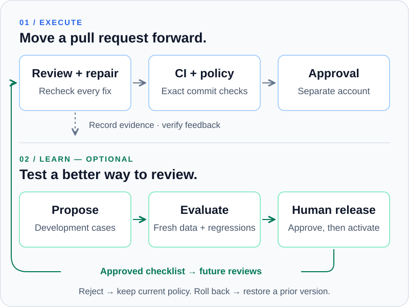

<div align="center">

# Harness4

### Own your PR workflow. Improve how it reviews.

Open-source review, repair and policy-gated approval — with an evaluated learning loop.

[](https://github.com/YangZhongqiHealth/harness4/actions/workflows/ci.yml)
[](LICENSE)
[](pyproject.toml)
[](planning/STATUS.md)

[Try it](#quickstart) · [How it works](#how-it-works) · [Use on GitHub](#use-it-on-your-repository) · [Claude Ship comparison](#harness4-and-claude-ship) · [Contribute](#build-with-us)

</div>

Harness4 helps maintainers move a pull request through review, bounded repairs,
CI checks and an approval decision. You run the coordinator, choose a compatible
model endpoint, and set the rules for what it may change.

**Its defining feature is a controlled learning loop:** verified feedback can become
a new review checklist, but only after separate evaluation and your approval.
Every activated checklist has a version you can inspect and roll back.

- **Own the workflow.** MIT source, self-hosted coordination and explicit write grants.
- **Choose the model.** Hosted or local Chat Completions-compatible endpoints.
- **Evaluate what it learns.** Fresh release data, regression checks and reversible activation.

## How it works



The execution loop operates on a pinned PR revision. It reviews again after a repair
and checks GitHub CI before optional approval. Blocked checks, exhausted repair
budgets and uncertain evidence return control to a person. It never merges PRs.

The learning loop runs separately, when you request it. It changes the **review
checklist**, while model weights, permissions and evaluation rules stay fixed.
[Detailed workflow diagrams →](docs/WORKFLOWS.md)

## Quickstart

**Python 3.11+ and Git.** Run these commands in a macOS/Linux shell:

```sh
git clone https://github.com/YangZhongqiHealth/harness4.git
cd harness4
python -m venv .venv
source .venv/bin/activate
python -m pip install .

# No model key, GitHub token or remote writes.
python examples/learning_demo.py
```

This runs the full learning lifecycle in temporary storage. Look for these fields
in the JSON output:

```json
{
  "evidence_class": "scripted_demo",
  "quality_claim": false,
  "decision": "eligible",
  "fresh_review_finding_count": 1,
  "rollback_review_finding_count": 0
}
```

**What you just saw:** a candidate checklist caught the fixture's missing-value bug;
activation changed the next review; rollback restored the original behavior. The
model responses are scripted. Persistence, evaluation, approval and rollback are real.
This proves the lifecycle works, not that a live model's accuracy improved.

For persistent demo state, use `h4 learning demo --state-dir /path/to/new-directory`.
Install this checkout; Harness4 is not yet published to PyPI.

## Use it on your repository

### 1. Inspect a committed change

```sh
h4 ship --repo /path/to/your/repo --base HEAD~1 --head HEAD
```

Without a model, this produces a read-only policy report. Add `--model YOUR_MODEL`
and `--base-url https://YOUR_PROVIDER/v1`, with `H4_MODEL_KEY` configured, for an AI
review. Only committed changes are included. [Local review guide →](docs/LOCAL_REVIEW.md)

### 2. Observe a GitHub PR

Follow the [GitHub setup guide](docs/GITHUB_WORKFLOW.md) to create an operator-owned
policy and configure `H4_GITHUB_TOKEN` and `H4_MODEL_KEY`. Then:

```sh
h4 ship-github --policy /trusted/project-policy.json --pr 42 \
  --state-dir /trusted/state/github \
  --model YOUR_MODEL --base-url https://YOUR_PROVIDER/v1
```

This reviews the PR without posting or modifying it. Model requests send code to
your selected endpoint and may incur charges. Enable `--write` only when the policy
grants the intended repairs. `--approve` additionally requires a separate GitHub
user credential and the documented branch protection settings.

### 3. Add learning when you have verified feedback

Initialize a learning store, then add `--learning-dir /trusted/state/learning` to
GitHub runs to record versioned review episodes. The learning directory is separate
from the write journal. Curate labels, freeze development and release datasets,
then run an explicitly budgeted evaluation.

Only an eligible report can proceed through `approve` and `promote`. Insufficient
evidence leaves the current policy in place. [Learning walkthrough →](docs/LEARNING.md)

## What self-improvement means here

Suppose reviews repeatedly miss code that turns a missing value into zero:

```python
return value or 0  # In this example, None must remain missing.
```

1. **Verify the mistake.** Attach correct finding labels to the recorded revision.
2. **Propose a reusable rule.** The learner uses development failures and correct
   examples to propose a checklist change about missing-value handling.
3. **Test beyond those examples.** Compare the candidate with the current checklist
   on fresh target cases and regression cases. Release labels stay out of model prompts.
4. **Adopt or abstain.** If the release gates pass, inspect and approve the exact
   version. Otherwise, keep the current checklist.
5. **Recover.** Roll back a policy, or retract incorrect feedback to invalidate
   dependent policies and restore baseline when needed.

That is the Harness 4.0 direction: **experience → evaluated change → controlled
adoption**. Today it applies to review guidance. Learning is opt-in; release cohorts
are used once, and defaults require at least 100 target and 100 regression source
groups. A single successful PR is not enough to release a new checklist.

[Evaluation rules and limits](docs/LEARNING.md) ·
[Research behind the design](docs/research/2026-11-25-learning.md)

## Harness4 and Claude Ship

Both target the review → fix → approval workflow. **Harness4's focus is ownership,
model choice and an inspectable learning lifecycle.**

| Dimension | Harness4 today | Claude Ship documentation |
|---|---|---|
| Operate and extend | Self-hosted, MIT-licensed coordinator | Claude organization service; Team/Enterprise setup. [Docs][ship-docs] |
| Model choice | Compatible hosted or local endpoint | Claude-based workflow. [Product][ship-product] |
| Review guidance | Verified feedback → independent evaluation → approved version → rollback | `REVIEW.md` customization; this learning-release lifecycle is not described in the reviewed pages. [Product][ship-product] |
| PR stewardship | Bounded repairs from its own findings; CI failures and conflicts escalate | Handles failing checks, merge conflicts and human/tool feedback. [Docs][ship-docs] |

Choose Harness4 if you want to operate and extend the engine, experiment with model
endpoints, or audit how review guidance changes. Claude Ship documents broader
stewardship and integrated onboarding. Harness4 is an early alpha; no head-to-head
accuracy or cost advantage has been measured.

Sources checked **2026-11-26**. “Not described” is a documentation observation, not a
claim about Anthropic's internal systems. [Detailed comparison and sources →](docs/COMPARISON.md)
Harness4 is an independent project, not affiliated with Anthropic.

[ship-docs]: https://code.claude.com/docs/en/claude-ship
[ship-product]: https://claude.com/product/claude-ship

## Project status

**0.6.0a0 · Alpha · 289 automated tests · CI on Python 3.11–3.13**

Implemented: local review, opt-in GitHub review/repair/approval, durable write
reconciliation, and the learning/evaluation/rollback lifecycle. Tests cover HTTP
adapters and real SQLite storage with simulated model and GitHub responses.

Next: live-provider and real-PR qualification, independently labeled quality
benchmarks, GitHub App onboarding, and isolated CI-failure/conflict repair. Current
GitHub support is limited to same-repository text PRs and classic branch protection.
The coordinator trusts its local OS owner; it is not a sandbox for untrusted code.

[Validation evidence](tests/VALIDATION.md) · [Implementation status](planning/STATUS.md) ·
[Product roadmap](planning/PRODUCT.md)

## Documentation

- **Use:** [Local review](docs/LOCAL_REVIEW.md) · [GitHub setup and recovery](docs/GITHUB_WORKFLOW.md) · [Learning](docs/LEARNING.md)
- **Understand:** [Workflow diagrams](docs/WORKFLOWS.md) · [Architecture](docs/DESIGN.md) · [Research](docs/research/2026-11-25-learning.md)
- **Integrate:** [Provider contract](docs/PROVIDERS.md) · [Persistence](docs/PERSISTENCE.md) · [Read-only Actions example](examples/ship-observe.yml)

## Build with us

The most useful contributions now are reproducible provider compatibility reports,
independently verified review cases, and failure/recovery tests. Keep ordinary tests
credential-free, and remove private source and secrets from shared examples.

```sh
python -m pip install -e '.[dev]'
python -m pytest -q
```

[Open an issue](https://github.com/YangZhongqiHealth/harness4/issues) ·
[Contribution guide](CONTRIBUTING.md) · [Security reports](SECURITY.md) · [MIT license](LICENSE)
