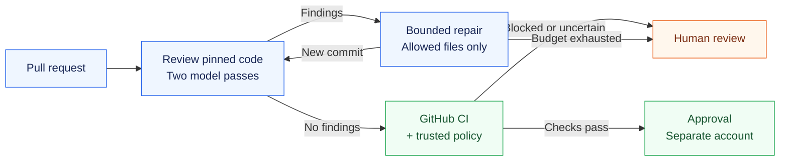
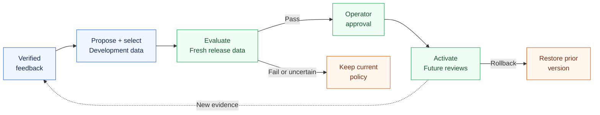

<div align="center">

# Harness4

### Review. Repair. Learn. Keep control.

**Open-source PR automation with a verifiable, reversible learning loop.**

[](https://github.com/YangZhongqiHealth/harness4/actions/workflows/ci.yml)
[](LICENSE)
[](pyproject.toml)
[](planning/STATUS.md)

[Quickstart](#quickstart) · [How it works](#how-it-works) · [Learning](#a-learning-loop-you-can-audit) · [Docs](#documentation) · [Contribute](#build-with-us)

</div>

Harness4 reviews pull requests, proposes bounded repairs, checks GitHub CI, and can
approve under rules you control. Its learning loop turns verified feedback into
candidate review strategies, tests them against fresh evidence, and lets you approve
or roll back the versions used by future reviews.

**Bring a compatible model endpoint. Run the coordinator on your infrastructure.
Keep your policies, evidence and approval decisions under your control.**

Built for maintainers automating PR review, teams that need auditable AI workflows,
and researchers testing how an agent's harness can improve over time.

## Why Harness4?

| What you want | What Harness4 gives you |
|---|---|
| **Follow through on a review** | A GitHub review → bounded repair → fresh review → CI → approval workflow. |
| **Learn from recurring mistakes** | Verified feedback becomes a candidate checklist, evaluated on separate target and regression cohorts. |
| **Control what changes** | Explicit write grants, protected paths, a separate approval account and human approval of learned policies. |
| **Understand what happened** | Commit-pinned reports, policy versions, durable write receipts and an auditable learning history. |
| **Recover when something goes wrong** | Evidence-based reconciliation of uncertain writes, policy rollback and revocation after feedback corrections. |
| **Choose your model** | An explicit Chat Completions-compatible endpoint, including local endpoints that satisfy the adapter contract. |

## Quickstart

**Python 3.11+ and Git.** Install from this repository; Harness4 is not yet published
to PyPI. These commands use a macOS/Linux shell:

```sh
git clone https://github.com/YangZhongqiHealth/harness4.git
cd harness4
python -m venv .venv
source .venv/bin/activate
python -m pip install .

# Run the complete learning lifecycle. No API key or GitHub token needed.
python examples/learning_demo.py
```

The demo creates temporary state, learns a candidate checklist, evaluates it,
activates it and rolls it back. Selected fields from its JSON output:

```json
{
  "evidence_class": "scripted_demo",
  "quality_claim": false,
  "decision": "eligible",
  "fresh_review_finding_count": 1,
  "rollback_review_finding_count": 0,
  "generation": 2
}
```

In this fixture, the new checklist catches a missing-value bug; rolling back restores
the original behavior. The demo uses scripted model replies and real persistence,
activation and rollback. It demonstrates the lifecycle, not real-model accuracy.

To keep the demo's audit history, use a **new directory**:

```sh
h4 learning demo --state-dir /tmp/harness4-learning-demo
h4 learning status --state-dir /tmp/harness4-learning-demo
```

## How it works

Two connected loops: one handles a pull request; the other evaluates changes to the
review guidance used on future pull requests.



Remote writes require explicit opt-in and trusted policy grants. Approval requires
passing checks on the reviewed commit, a separate GitHub user and branch protection.
The coordinator does not execute PR code or merge PRs. See the
[GitHub workflow guide](docs/GITHUB_WORKFLOW.md) for setup and recovery.

### Start with a local review

Inside the cloned repository, inspect the latest committed change without credentials:

```sh
h4 ship --repo . --base HEAD~1 --head HEAD
```

This produces a structured policy report without calling a model. To review another
repository with a model, configure `H4_MODEL_KEY` in your environment, then run:

```sh
h4 ship --repo /path/to/your/repo --base HEAD~1 --head HEAD \
  --model YOUR_MODEL --base-url https://YOUR_PROVIDER/v1 \
  --policy examples/ship-policy.json --checks unknown
```

Only committed changes are reviewed. Model calls send the diff to your configured
endpoint and may incur charges. Local recommendations are advisory; the local
command's exit code is not a merge gate. [Local review reference →](docs/LOCAL_REVIEW.md)

### Connect a GitHub repository

Configure your repository policy, model credential and GitHub token using the
[setup guide](docs/GITHUB_WORKFLOW.md), then start in observation mode:

```sh
h4 ship-github --policy /trusted/project-policy.json --pr 42 \
  --state-dir /trusted/state/github \
  --model YOUR_MODEL --base-url https://YOUR_PROVIDER/v1
```

Add `--write` to allow policy-permitted review posts and repairs. Add `--approve`
only after configuring the separate approval credential and branch protection.
To use an approved learned checklist and record feedback episodes, add
`--learning-dir /trusted/state/learning` after [initializing learning](docs/LEARNING.md).

## A learning loop you can audit

A useful lesson needs evidence before it becomes the next review policy.



- **Separate development from release evidence.** The proposer sees development
  labels; the release cohort is consumed once, including after a crash.
- **Check improvement and retention.** Paired evaluations compare candidate and
  current policy. Confidence bounds and regression checks can reject or abstain.
- **Approve the exact version.** Activation checks the persisted report, policy
  generation, evidence validity, expiry and a one-use approval.
- **Reverse a decision.** Roll back an active policy, or retract incorrect feedback
  to invalidate dependent policies. The original baseline remains available.

The learnable surface today is the **review checklist**. Model weights, GitHub
permissions, execution code and evaluation rules stay fixed. Production learning
requires explicit inference budgets and independent, verified data; the default
gate requires at least 100 target and 100 regression source groups.

[Run a real learning cycle →](docs/LEARNING.md) ·
[Research and design decisions →](docs/research/2026-11-25-learning.md)

## What “4” stands for

Our Harness 4.0 direction is an agent workflow that can **learn from verified
experience, evaluate a change, and adopt or reverse it under explicit control**.
The current release implements that direction for PR review guidance. “4” names the
project's architectural ambition; the package is currently **0.6.0a0, an alpha**.

We are building an open-source alternative for the PR workflow introduced by
[Claude Ship](https://claude.com/resources/articles/introducing-claude-ship), with
model choice and an inspectable learning lifecycle as central design goals.
Harness4 is independent of Anthropic. Feature parity and superior review quality
remain goals to validate, not benchmark results we claim.

## Built today, measured honestly

**289 automated tests** cover contracts, provider behavior, persistence, GitHub
orchestration and learning. CI checks Python 3.11–3.13, runs credential-free examples
and builds the package. A synthetic integration exercises 809 mocked model requests,
policy activation, GitHub review, rollback and restart deduplication.

| Available in this alpha | Next milestones |
|---|---|
| Local review and the opt-in GitHub lifecycle | Live provider and real-PR qualification |
| Verified-feedback learning, evaluation and rollback | Public, independently labeled quality benchmarks |
| Private local state and durable write reconciliation | GitHub App installation and webhooks |
| Same-repository text PRs and classic branch protection | Fork support, isolated CI-failure and conflict repair |

These tests establish implementation behavior. Live quality gains have not yet been
measured. The coordinator trusts its local OS owner; model/learner separation is not
an OS sandbox. [Validation evidence](tests/VALIDATION.md) · [Current status](planning/STATUS.md)

## Documentation

| Start here | Go deeper |
|---|---|
| [Local review](docs/LOCAL_REVIEW.md) | [Model gateway and conformance](docs/PROVIDERS.md) |
| [GitHub setup and recovery](docs/GITHUB_WORKFLOW.md) | [Persistence and recovery semantics](docs/PERSISTENCE.md) |
| [Learning, approval and rollback](docs/LEARNING.md) | [Learning research](docs/research/2026-11-25-learning.md) |
| [Read-only GitHub Actions example](examples/ship-observe.yml) | [Architecture](docs/DESIGN.md) · [Product acceptance plan](planning/PRODUCT.md) |

## Build with us

Help make evidence-based PR automation useful in real repositories. Especially
valuable contributions: reproducible provider compatibility reports, independently
verified review cases, failure/recovery tests, and onboarding improvements.

```sh
python -m pip install -e '.[dev]'
python -m pytest -q
```

[Open an issue](https://github.com/YangZhongqiHealth/harness4/issues) with a reproducible
problem or proposed contribution. Read [CONTRIBUTING.md](CONTRIBUTING.md) before a PR
and [SECURITY.md](SECURITY.md) for sensitive reports. Please remove credentials and
private source from examples. If this direction matters to you, star the repository
and help us test it against real engineering work.

[MIT licensed](LICENSE). Your infrastructure. Your model endpoint. Your review policy.
