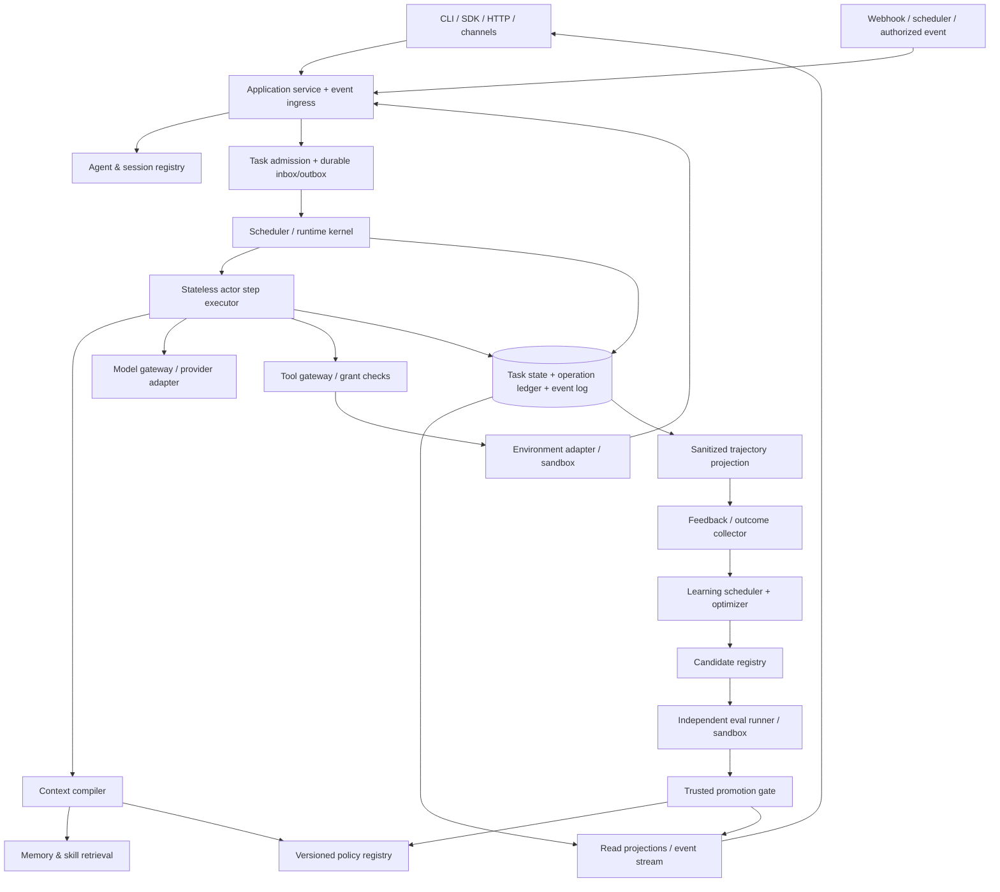
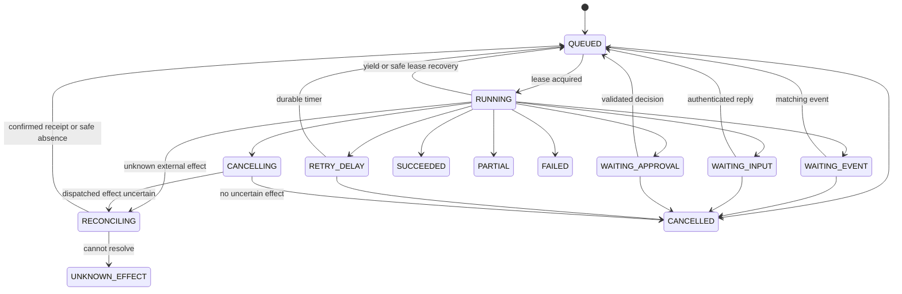
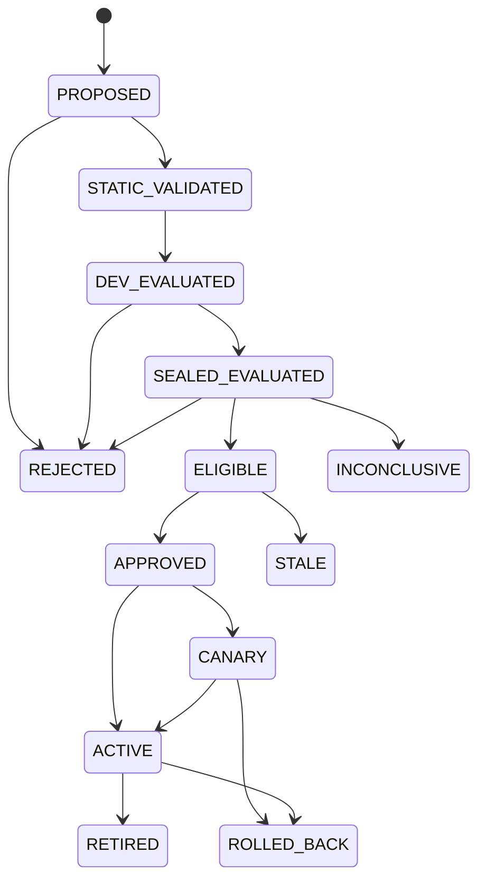
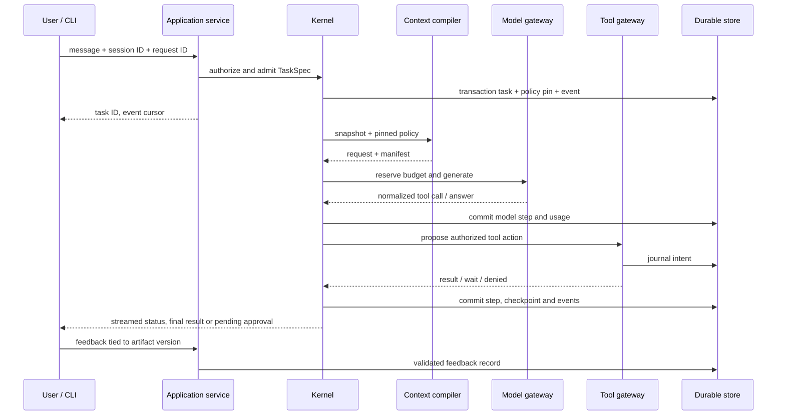
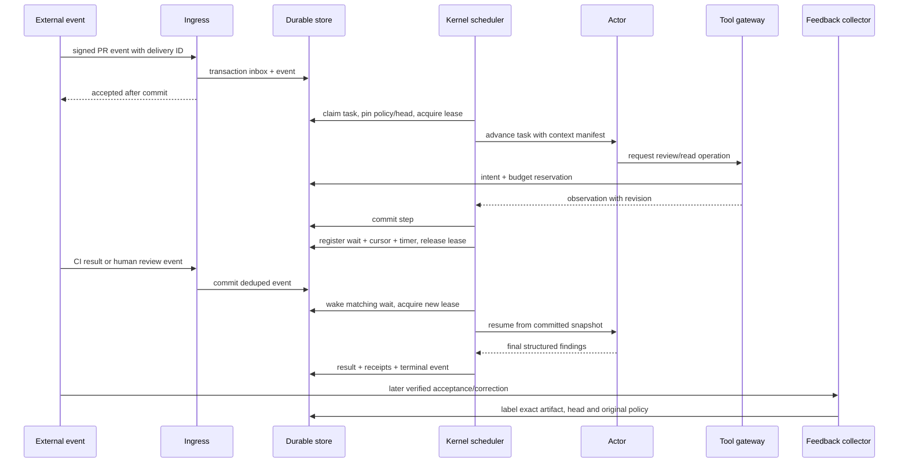
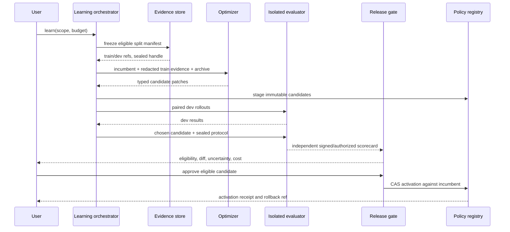

# Harness 4.0 — Durable, Provider-Agnostic, Continually Improving Agent Runtime

**RFC 0001 · DESIGN v0.2 · 2026-11-23**
**Status:** proposed normative implementation specification; supersedes DESIGN v0.1 and incorporates ARCHITECTURE_REVIEW v0.2.
**Audience:** maintainers, coding agents, researchers, domain-plugin authors, security reviewers.
**Working name:** `harness4` / `h4`; package name not reserved or verified.
**Language:** Python-first, self-hosted, API-only model access; MIT (selected by the project owner for the public alpha).
**Evidence boundary:** documented mechanisms of public projects are research inputs, not independently reproduced comparative results. All interfaces, configuration examples, thresholds and performance goals below are proposed, not implemented.

## Reading map

| Part | Question answered | Sections |
|---|---|---|
| Product | Who uses it, what happens after install, what does the user see? | 1–3 |
| Architecture | What owns state and how do components communicate? | 4–5 |
| Execution | How does a model call become a safe, durable task? | 6–10 |
| Learning | How does experience become measurable improvement? | 11–15 |
| Delivery | How to build, test, benchmark, release and maintain? | 16–22 |

Normative language: MUST denotes a required invariant for the milestone that implements a capability; SHOULD is a default with an explicit exception; MAY is an optional extension. P0 = first vertical slice, P1 = durable integration release, P2 = advanced research. Nothing marked P2 is required for the P0 quickstart.

## 1. Executive decision and product contract

Build a portable runtime that wraps a user's LLM API with context, tools, task management, persistent state, event handling and a second, independent learning loop. The result is an immediately usable personal assistant, an automation daemon and a developer SDK over one service layer. **Do not ship three separate agent implementations.** The default product must operate with one model endpoint and one API credential. A user may choose a local endpoint with no credential. No mandatory hosted orchestration, embedding API, vector database, GPU training, separate judge model, or vendor-specific coding CLI.

The most important architectural decision is **trusted runtime kernel + versioned evolvable policy + isolated evaluator**. The learner is untrusted code from the perspective of authorization. It can suggest more useful ways of solving tasks but cannot acquire new privileges, change safety boundaries, modify trusted evaluation criteria, inspect sealed cases, or activate itself. The kernel is not literally immutable across software releases: maintainers can upgrade it through the normal reviewed software release process; it is immutable *to the agent and learner* at runtime.

### 1.1 Product acceptance narrative

A new user runs `h4 init`, selects their model provider, enters a model ID and key, and runs `h4 chat`. The default assistant answers, accesses explicitly mounted workspace files, writes artifacts within an allowed directory, asks for missing input, and records a durable task outcome. The user can later type `h4 demo learning --live` to exercise a controlled domain with feedback. They can inspect what the system learned, compare a candidate with the incumbent, approve an eligible update, and undo it. They do not write a system prompt or a Python agent loop. When they enable `h4 serve`, the runtime remains responsive to events without paying for inference while idle.

An API key grants inference only. Connecting GitHub, email, calendar, web retrieval, arbitrary code execution or another application requires appropriate separately granted capabilities and sometimes another application's credentials. General conversation without objective feedback may accumulate authorized preferences and proposed experience, but it cannot establish improved objective performance. An API-only user must have a useful assistant even when the learning gate has no evidence.

### 1.2 What H4 actually means

H1: a model with bounded tools. H2: context, planning, memory and subagents. H3: durable execution and governance across events. H4: cross-task policy changes evaluated on future/unseen tasks and deployed with regression controls. This taxonomy is project-specific, not an industry standard. H4 is not a guarantee of AGI, autonomous weight training, or improvement on every individual task.

### 1.3 Non-goals and scope boundaries

P0 excludes arbitrary kernel edits, automatic executable-tool generation, unrestricted shell/browser, multi-tenant SaaS, distributed execution, automatic PR merge, universal evaluators and self-provisioned model accounts. P1 adds safe long-running integrations; P2 explores learned workflows, adaptive routing, controlled code-level harness search and privacy-approved transfer. Do not call prototype H4 evidence of state-of-the-art performance until the controlled experiments in §19 are complete.

### 1.4 Differentiation hypotheses (not claims)

The landscape already includes robust harness optimization, learning adapters and long-running assistants. We aim to combine them, not claim to invent each feature. Four experimentally testable hypotheses: (H-A) component-local interventions and causal trace lineage yield better improvement per evaluation dollar than broad prompt rewrites; (H-B) scoped knowledge and per-family regression tests reduce negative transfer under changing task distributions; (H-C) a model-portable runtime with secure evidence-gated activation is easier to deploy on real tasks than benchmark-specific optimization; (H-D) learning scheduling based on expected future value reduces total cost relative to optimizing after every task. Each is an experiment, not a release claim.

## 2. User journeys, APIs and visible outputs

Two personas share one runtime. A personal user starts a default agent and chats, provides files, asks for work, reviews artifacts, corrects mistakes and optionally enables scheduled or triggered tasks. A developer defines domain agents and registers typed tools, triggers, evaluators and environments. Neither must write a custom agent loop. An administrator controls capabilities, credentials, budgets and learning activation. In a local deployment these may be the same human.

### 2.1 Five-minute first run

```sh
# Proposed commands; package name not verified.
pip install harness4
h4 init                   # choose endpoint, model and key; interactive secure input
h4 doctor                 # capability and connectivity checks; disclose any paid probe
h4 chat                   # persistent default assistant, safe workspace access
h4 run 'Extract action items from ./meeting.md'
h4 serve                  # start local daemon, no inference while idle
```

Defaults: one workspace, one default agent, one model for actor/learner/judge, local data store, safe explicitly mounted workspace, no external write access, no mandatory embedding model, no mandatory network services except the chosen endpoint. The assistant can read user-granted files, do text work, produce artifacts and ask questions. No arbitrary shell or unrestricted browsing by default. App-specific tools need separate credentials. Learning defaults to collecting authorized evidence and proposing changes, not spending silently or modifying behavior automatically. An API-only user can run a reproducible bundled learning demo; a free-form task without verified feedback is not a proof of improvement.

### 2.2 Interactive, background and developer entry points

`h4 chat --agent default`: persistent session with streamed visible output, tool progress, attachments, explicit approvals and feedback. Commands `/tasks`, `/memory`, `/skills`, `/learning`, `/approve` and `/stop` are UI affordances, not new authority. `h4 run` runs one task in-process or submits to the local daemon; `--background` requires a running daemon and returns a task ID. `h4 tasks`, `h4 inspect`, `h4 cancel`, `h4 resume`, `h4 feedback` manage the lifecycle. `h4 agent create`, `h4 agent list`, `h4 trigger add`, `h4 learning status`, `h4 candidate show`, `h4 promote`, `h4 rollback` manage agent configuration and evolution. The same service layer is used by CLI, SDK and HTTP; do not implement separate loops. A future local web UI consumes the same event protocol.

HTTP: `POST /v1/agents`, `POST /v1/sessions`, `POST /v1/sessions/{id}/messages`, `POST /v1/tasks`, `GET /v1/tasks/{id}`, `GET /v1/tasks/{id}/events?after=...` (SSE), `POST /v1/tasks/{id}/cancel`, `POST /v1/events`, `POST /v1/feedback`, `POST /v1/approvals/{id}/decision`, `GET /v1/learning/candidates`, `POST /v1/learning/candidates/{id}/promote`. Creation returns durable IDs, status and stream cursor; retry-safe request keys. Use authenticated local endpoint or in-process API; remote access disabled until explicitly configured. Scope every lookup to authenticated workspace. UI reconnects by event sequence, not by rerunning the task.

### 2.3 Output contract (three different products)

1. **Task output:** answer, files/artifacts, citations/evidence when available, action receipts, verification status, unresolved requests. A task that partially completed or has ambiguous external effects must say so. Distinguish generated proposal from action already executed.
2. **Runtime output:** live `task.started`, `message.delta`, `tool.started`, `tool.completed`, `approval.required`, `task.waiting`, `task.completed`, `task.failed`, `task.cancelled` plus progress summaries. Do not expose hidden reasoning or raw secrets. Deltas are advisory; terminal messages and durable events are authoritative. An approval has precise action/destination/effect, expiry, version and one-time decision token.
3. **Learning output:** evidence, candidate diff, scope, evaluation sample size and uncertainty, incumbent comparison, costs, risk findings, promotion/rejection decision, current policy and rollback target. Do not claim learning occurred on merely saving a note. Explain why no evidence/insufficient budget if no update is made.

```python
class TaskResult(BaseModel):
    task_id: str
    session_id: str | None
    status: TaskStatus  # succeeded, partial, failed, cancelled, waiting, unknown_effect
    message: str | None
    artifacts: list[ArtifactRef]
    action_receipts: list[ActionReceipt]
    verification: VerificationReport | None
    pending: list[PendingRequest]
    usage: UsageSummary
    policy_version: str
    model_ref: ModelRef
    trace_id: str
```

Use typed status plus human-readable text; separate task completion from correctness (`verified`, `unverified`, `failed_verification`). Stream visible assistant text, summaries and structured tool status, never hidden chain-of-thought. Artifact references include MIME type, digest, path/authorized retrieval endpoint, provenance and retention. Users can export a trace and delete eligible personal data. Audit metadata may remain tombstoned without sensitive contents.

Example final display (illustrative): `Completed: action-items.md | 8 items extracted | verified against source: 7/8; one owner unclear | no external changes | model X | policy v3 | $0.03 estimated | feedback: correct / revise`. Example learning display: `Candidate C7: clarify ambiguous owners. 12 labeled examples; 20 held-out cases; 15/20 → 17/20; uncertainty high, not promoted. Review diff.` Numbers are fictional.

### 2.4 Default onboarding contract and configuration

The application service exposes `Harness.open(config)` in the SDK; CLI `init` creates local config and credential references (never stores raw keys in config). `doctor` validates configuration, reports estimated costs and performs a paid probe only with consent or an explicit `--probe` flag. No model ID guessed when provider requires a specific ID. Defaults apply only after capability negotiation. Config merge precedence: bundled defaults < workspace file < explicit environment configuration < user CLI overrides; kernel ceilings always intersect, never expand. An operator-only configuration update increments grant epoch and is audited. Project files and skill files cannot override trusted configuration.

```yaml
schema_version: 1
workspace: default
model:
  provider: openai_compatible  # litellm, anthropic, gemini, custom
  name: YOUR_MODEL_ID
  base_url: http://localhost:8000/v1
  api_key_env: H4_MODEL_KEY    # optional for local server
roles: {actor: default, learner: default, judge: default}
runtime:
  store: sqlite
  data_dir: ~/.harness4
  max_workers: 2
  max_steps_per_run: 30
  max_runs_per_task: 8
  max_task_tokens: 100000
  max_task_active_seconds: 300
  max_task_wall_seconds: 3600
  task_cost_limit_usd: null    # set only with known or conservative pricing
security:
  profile: safe_local
  workspace_read: [./workspace]
  artifact_write: ./artifacts
  external_writes: deny
  telemetry_export: false
learning:
  mode: propose
  schedule: manual           # no surprise inference charges
  min_labeled_tasks: 20      # trigger only, not statistical sufficiency
  max_cycle_tokens: 100000
  max_candidates: 4
  allowed_surfaces: [instructions, retrieval, skills]
  auto_promote_surfaces: []
  raw_content_retention_days: 30
```

`learning.mode=propose` means allowed evidence collection and explicitly scheduled/requested optimization, never silent paid calls just because the mode exists. User may enable automatic low-cost learning under explicit daily and per-cycle budgets. All configured USD ceilings require a conservative known price bound, otherwise token-only mode must be explicit. `off` disables learner jobs and behavioral adaptation; whether ordinary session storage continues is a separate retention control.

### 2.5 SDK and CLI semantics

```python
from harness4 import Harness, AgentDefinition, TaskSpec

async with Harness.open('harness.yaml') as h:
    agent = await h.agents.get_or_create(AgentDefinition.default())
    session = await h.sessions.create(agent.id)
    task = await h.tasks.submit(TaskSpec(agent_id=agent.id,
        session_id=session.id, goal='Summarize this workspace',
        request_key='client-generated-uuid'))
    async for event in h.tasks.events(task.id, after=0):
        render(event)
    result = await h.tasks.result(task.id)
```

`submit` is durable acceptance, not successful completion. `run` convenience calls submit then awaits terminal result or pending input; `chat` creates or resumes a session and returns control for a pending question; background tasks have no session requirement. User replies to an explicit pending question ID; sending an unrelated chat message creates a new turn, never silently approves an action. Session ordering: one active conversational task per session by default, queue additional turns or let user explicitly cancel; background events can use separate task scope. `h4 stop` signals cancellation, while `h4 serve --stop` is daemon shutdown and leaves resumable work. `h4 learning status` is a read-only operation and never triggers inference. `h4 candidate diff`, `h4 learn --dry-run`, `h4 promote`, `h4 rollback` expose explicit lifecycle controls.

| Public command | Return value | Error semantics |
|---|---|---|
| `init`, `doctor` | configuration path, capability report | validation/auth failure with remediation |
| `chat`, `run` | streaming display + TaskResult | pending/partial/failed states, not generic success |
| `serve`, `emit` | daemon status / event receipt | not-running, unauthorized, duplicate delivery |
| `tasks`, `inspect`, `cancel`, `resume` | projections and command receipts | unknown effect reported explicitly |
| `feedback`, `memory list/edit/forget` | versioned feedback or knowledge-change receipt | deny if outside scope; invalidate derivatives |
| `learn`, `evaluate`, `candidate show` | LearningReport / CandidateReport | ineligible or inconclusive is normal |
| `promote`, `rollback` | activation event and active policy ref | stale parent, invalid gate, operator denial |

API returns structured error codes: `INVALID_CONFIG`, `UNAUTHORIZED`, `CAPABILITY_UNAVAILABLE`, `BUDGET_EXHAUSTED`, `STALE_VERSION`, `WAITING_FOR_INPUT`, `UNKNOWN_EFFECT`, `EVIDENCE_INSUFFICIENT`, `CANDIDATE_STALE`. HTTP maps to ordinary transport status (e.g., 409 conflict) but domain state is a typed payload. SDK contracts versioned separately from database migrations. All commands accept request IDs; repeated same key + same payload returns prior receipt, same key + different payload conflicts.

### 2.6 Output and user trust details

The interface is a projection of committed events, not an execution mechanism. Streaming text may appear before commit and be marked provisional; on reconnect the UI reconstructs from committed messages and event cursors. An answer may be successful as a task but unverified factually. The result MUST state external actions that actually occurred, artifacts that were created, pending approvals, errors/unknown effects and any necessary next step. Never report an intended email, PR, file or payment as already sent/created if the receipt is absent. Expose optional evidence links and concise action summaries; no private model reasoning is required or displayed. Default display is concise; `/inspect` shows versions, usage, tool timeline, manifest and evidence when authorized.

Learning report schema: `cycle_id, scope, reason, evidence_count_by_type, data_manifest_hash, optimizer_id, candidate_refs, cost_usage, incumbent_ref, holdout_protocol_ref, paired_effects, confidence_interval, anchor_results, gate_reasons, decision, effective_policy_ref, next_eligible_condition`. If there is no valid holdout, report proposed insights without a pass. A candidate diff is readable by user and includes applicability, old/new content, provenance (redacted), tradeoffs and rollback target. Show estimated and actual usage separately; do not equate learning attempts or memory count with verified gains.

## 3. System constraints and release tiers

| Tier | Supported environment | Activation policy |
|---|---|---|
| P0 local research | Local read-only files, artifact directory, deterministic simulator, one model | Manual only after independent gate; no arbitrary code |
| P1 durable runtime | Single host daemon, events, approved read-only application plugins, scoped writes only when reconciliable | Manual, plus optionally narrowly scoped low-risk canary |
| P2 advanced | Multi-host optional backend, bounded workflow/routing evolution, adapter optimization, safe code research | Validated-auto only for explicitly allowlisted surfaces; executable changes human-reviewed |

Minimum host assumptions: supported Python, writable private data directory on local disk, outbound model endpoint connectivity. No public server binding by default. Linux/macOS/Windows local file tools should be cross-platform; untrusted code execution is disabled unless a supported sandbox is configured and verified. A malicious host administrator or compromised kernel is outside threat-model guarantees. Concurrent local CLI and daemon must not become independent schedulers over the same workspace: one elected coordinator, clients communicate over local authenticated IPC/HTTP, or exclusive in-process lock.

## 4. Canonical domain model

| Object | Meaning / identity | Owner and lifecycle |
|---|---|---|
| Workspace | User/project trust and data boundary | Kernel; explicit creation/deletion |
| AgentDefinition | Declarative role, tools, triggers, objective/evaluator bindings, initial policy | Operator; versioned, references not secrets |
| AgentInstance | Stable deployed agent ID and active policy pointer | Registry; enable/disable independently of sessions |
| Session | Conversation/channel thread, authorized user and history | Session service; many tasks, serial turns by default |
| TaskSpec | Goal, inputs, resource keys, constraints, expected output, completion/evaluation specification | Task service; admitted and pinned at submission |
| Task | Durable logical work unit; may wait/resume; optional session | Scheduler; one root budget and policy snapshot |
| Run | One execution lease/attempt to advance task | Worker; fresh lease and generation on resume |
| Step | Model call, tool operation, deterministic transition or wait | Kernel; monotonic task sequence, immutable committed records |
| Environment | Authorized state observation, action execution, reset/snapshot or simulator if possible | Domain connector; versioned capabilities |
| Feedback | External, human or deterministic outcome observation tied to artifact and policy | Feedback service; provisional/verified/disputed |
| PolicyBundle | Evolvable prompts, skills, retrieval, routing, bounded workflow | Policy registry; immutable content hashes |
| Candidate | Proposed patch with hypothesis, evidence and evaluation result | Learner proposes; release gate owns activation |

A session can host many tasks; background events need no session. An agent instance can host many sessions and tasks. A task can have many runs and subtask children. A new policy activates for newly admitted tasks; do not switch policy mid-task by default. An explicit migration creates a new task or versioned migration record and revalidates pending actions. Emergency security revocation overrides every pinned task. Conversation history is a projection; it is not the task's complete durable execution state. This fixes the ambiguity in v0.1 where a run pins policy but a task also has a policy ID.

```yaml
agent: default
role: general_assistant
model: default
policy: builtin/default@1
capabilities: [workspace.read, artifacts.create, user.ask]
objective:
  completion: user_request
  evaluators: [human_feedback]
learning:
  scope: agent
  mode: propose
  surfaces: [instructions, skills, retrieval]
triggers: []
```

An instance-specific objective is required for quality optimization; generic assistants may begin with user feedback and learn narrowly scoped preferences or procedures. Never assume a universal scalar reward. Credentials and permissions live in operator-managed grants, not this file. A connector manifest may suggest capabilities but cannot grant them.

### 4.1 Identity, version and lineage rules

All identifiers opaque, workspace-scoped, stable across retries. `definition_revision`, `policy_hash`, `capability_profile_hash`, `provider_config_hash`, `tool_manifest_hash`, `outcome_spec_hash`, `security_epoch` are distinct. Secret material is never part of a hash or trace; only credential reference and generation. Policy pin per admitted **task**, including its descendants, not each run; mutable user facts and revocations are separate versioned inputs read at each model step and captured in manifest. For evaluation the entire knowledge view is frozen. A run is a fenced lease interval, a step a logical committed action, and an attempt a retry of an operation/model request. `task_id` and `operation_id` survive retry and crash. `run_id` changes on takeover. Session contains ordered user/assistant messages, not private thought or external-effect state. A task can start without a session, but cannot exist without a workspace, agent and pinned definition/policy.

```python
class TaskSpec(BaseModel):
    agent_id: str
    session_id: str | None = None
    goal: str
    inputs: tuple[ArtifactRef, ...] = ()
    resources: tuple[ResourceKey, ...] = ()
    requested_capabilities: tuple[str, ...] = ()
    outcome_spec_ref: str | None = None
    output_schema_ref: str | None = None
    request_key: str
    deadline: datetime | None = None
    parent_task_id: str | None = None
```

The external TaskSpec cannot set its own policy version, trusted outcome function, approval status or effective grants; the admission service resolves these from authenticated agent definition and operator configuration. Evaluation admission may pin candidate under isolated evaluation identity. Artifact references include digest, logical name, MIME, size, ACL, creation origin and deletion state. Immutable identifiers can become tombstones if private data deleted.

### 4.2 Policy/knowledge scope hierarchy

Workspace > agent instance > project/domain > task family; optional user-specific overlay only with explicit grants. All referenced objects must belong to authorized scope. Resolved `PolicyView` = base bundle + explicitly authorized compatible scoped overlays, conflict rules specified in §11. No implicit cross-workspace sharing. Memory retrieval is always filtered by ACL before scoring, and egress authorization is checked even for model requests. An operator may export scrubbed policy bundles, but recipients must re-evaluate and authorize them.

## 5. Architecture, dependency and component map



Dependency direction: contracts → application/kernel interfaces → storage and provider/environment implementations. Actor does not write database directly. Learner does not call production tools or modify active pointer. UI reads projections and issues typed commands, never mutates state itself. Use explicit dependency injection. No framework-specific objects crossing public interfaces.

| Component | Input → output | State owner / integration | Reference pattern and design decision |
|---|---|---|---|
| Entry/application service | User message/event → admitted task, event cursor | Agent/session registry; auth, dedup | OpenClaw gateway and Hermes interactive flow; own simple service |
| Scheduler | Runnable task, wake events → fenced run lease | Kernel + SQLite | Temporal activities and LangGraph interrupts; SQLite first, pluggable backend later |
| Actor step | Snapshot + policy → typed decision | Kernel commits; actor stateless | OpenHands stateless agent/event model; reuse pattern, not coding-only abstraction |
| Context compiler | Task, policy, history, observations → ModelRequest + manifest | Read-only state/memory/skills | Progressive disclosure, compaction, bounded retrieval; own compiler |
| Provider gateway | ModelRequest → normalized response/stream/usage | Credential broker + budget ledger | LiteLLM optional adapter; provider contract ours |
| Tool gateway | Proposed action → validated result/receipt/wait | Operation ledger, authorization, sandbox | MCP compatibility + typed local tools; no MCP metadata as authority |
| Memory/skills | Retrieval query / proposed update → versioned references | Scoped stores, policy registry | Hermes, ACE, Agent Skills; FTS first, optional embedding index |
| Outcome/trace | Committed steps + external outcomes → sanitized trajectory + label | Immutable version refs; retention | OpenTelemetry export optional; separate telemetry from learning dataset |
| Optimizer | Evidence + base policy + search space → candidate patches | Candidate DAG/archive | GEPA, AutoSaddler, Hermit adapters; start simple |
| Evaluation | Candidate + frozen cases + environment → scorecard | Independent evaluator/sandbox | Held-out rollout vs incumbent, not trace-only replay |
| Release gate | Candidate + scorecard + operator rules → atomic activation/reject | Trusted registry | Immutable releases, canary, rollback; no optimizer self-approval |

### 5.1 Dependency graph and isolation

`contracts` has no implementation imports. `ports` defines typed protocols for storage, model, environment, policy, auth, evaluation and clock. `kernel` implements transitions, authorization and orchestration using injected ports. `execution` computes proposed decisions; never imports DB implementation or credentials. `adapters` implement ports; production adapters registered only by trusted operator. `learning` depends on redacted evidence read port, candidate registry write port and evaluation submission port; it cannot import live tool broker or release activation repository. `application` owns commands/queries and auth context; `ui`, `http`, `cli` depend only on it. `recipes` register domain definitions through public plugin protocol. Dependency tests use import checks plus permission tests; Python imports alone are not a security boundary. Learner/evaluator/tool workers run in isolated processes with distinct credentials and no raw DB write access when untrusted code is involved.

### 5.2 Component contract conventions

Every port receives a typed request, explicit authorized scope, deadline/cancellation token and pinned versions. Return a typed outcome (`Ok`, `Retryable`, `Denied`, `Stale`, `Unknown`, `Invalid`) with provenance; no free-form error as sole control signal. External effects require an operation identity, authorization, resource version and receipt. Only kernel commits authoritative state changes. Adapters can return observations but not issue permissions. Critical events persist before UI emission. Each module has a contract test suite, fixture adapter and fault-injection scenario; deterministic components must be runnable without an LLM.

## 6. Model gateway and agent execution

### 6.1 Provider portability

#### 6.1.1 Design decision

Use a thin, owned provider interface; implement a LiteLLM adapter initially for provider breadth and a direct OpenAI-compatible adapter for local/custom servers. Add native adapters where a provider's protocol or features require it. LiteLLM provides a unified interface over many providers [R1], but it must not be the public type system or a hard dependency of every deployment. Pin and audit dependencies; raw vendor payloads stay inside adapters. No hidden fallback to a third-party endpoint.

```python
class ModelProvider(Protocol):
    async def capabilities(self, model: ModelRef) -> CapabilityProfile: ...
    async def generate(self, request: ModelRequest) -> ModelResponse: ...
    def stream(self, request: ModelRequest) -> AsyncIterator[ModelDelta]: ...
```

`ModelRequest`: model reference, ordered messages with content blocks and provenance, tool specs, output schema (optional), generation settings, deadline, maximum output tokens, request ID. `ModelResponse`: visible text, normalized tool calls with stable IDs, finish reason, usage and usage confidence, provider request ID, model revision if available, opaque continuation handle if needed. Never require access to private chain-of-thought or treat provider-specific reasoning internals as portable.

#### 6.1.2 Capability negotiation and fallback

| Capability | Full profile | Reduced profile / failure behavior |
| --- | --- | --- |
| Chat generation | Required | Fail fast if unavailable |
| Native tool calling | Normalized tool call/result IDs | Bounded JSON action grammar, schema validation; read-only unless explicitly qualified |
| Structured output | Native JSON schema | Parse and validate, limited retry, fail closed |
| Streaming | Stream text/tool deltas | Buffered response; do not execute partial tool arguments |
| Context size | Verified model limit or user override | Conservative truncation/summarization, never remove mandatory policy |
| Usage reporting | Actual provider usage | Conservative estimate/reservation; mark uncertainty |
| Embeddings | Optional adapter | SQLite FTS5 lexical retrieval; no second key required |
| Model pinning | Explicit revision where possible | Record alias/provider and detect behavior drift; no exact-reproduction claim |

Discovery combines adapter-declared capabilities, configured model metadata and opt-in inexpensive probes. `h4 doctor` displays which profile is available and any limitations. Text-only fallback has no guarantee of reliable function calling; it is disabled for sensitive writes. For transient 429/5xx errors, bounded exponential backoff with jitter and Retry-After support; invalid auth/config are terminal. Alternate-model fallback requires user opt-in, compatible capabilities and budget; never transfer data to a new provider without authorization.

Normalize multimodal content only when supported. Preserve tool-call grouping and provider continuation semantics. Maintain adapter contract tests using recorded/redacted fixtures and optional live smoke tests across at least three provider families and a local endpoint. Provider credential isolation: model key belongs to provider client only; tools, sandboxes and learner receive neither keys nor unrestricted access to provider transport.

#### 6.1.3 Canonical protocol and conformance

```python
class ModelRequest(BaseModel):
    request_id: str
    model: ModelRef
    messages: tuple[Message, ...]  # role + discriminated content blocks
    tools: tuple[ToolSchema, ...]
    output_schema: dict | None = None
    max_output_tokens: int
    deadline: datetime
    generation: GenerationSettings
    continuation_ref: str | None = None

class ModelResponse(BaseModel):
    request_id: str
    text: tuple[TextBlock, ...]
    tool_calls: tuple[ToolCall, ...]
    finish: FinishReason
    usage: Usage
    provider_request_id: str | None = None
    model_revision: str | None = None
    continuation_ref: str | None = None
```

Content blocks: `Text`, `ImageRef`, `ArtifactRef`, `ToolUse`, `ToolResult`; each has provenance and authority label. Map developer/system roles explicitly; adapters unable to preserve mandatory authority must report degraded capability, not claim equivalence. Do not ask for or store hidden chain-of-thought. Some providers require opaque signed continuation items: retain encrypted short-lived adapter-specific opaque data only when needed, never feed to other providers or learner. `ToolCall.call_id` must be normalized and stable for the logical response even if provider ID missing; synthesize from request ID + ordered index. Result blocks match exact tool call IDs and preserve required ordering. Malformed or incomplete calls never reach tools. Streaming: buffer tool args until validated terminal call, persist final normalized batch; partial visible deltas have provisional IDs and cannot trigger an effect. Recovery may need a new paid model attempt if provider does not support retrieval; track ambiguous usage as conservative reservation until reconciliation, never silently assume zero.

Capability profile includes verified vs declared fields and timestamp; request-level capabilities (tool support, parallel calls, schema, image, max context/output, usage, streaming, cancellation, cache hints, model revisions). Native tool calling is preferred; fallback uses constrained JSON with strict discriminators, limited retry and reduced grants. Unknown context size uses operator override or conservative bound. Reject unsupported required modality or structured format with remediation. `doctor` uses canned tests for role handling, tool call/result roundtrip, malformed args, multiple calls, truncation, streaming termination, usage normalization and error taxonomy. Provider contract fixtures run for OpenAI-compatible, Anthropic-like and Gemini-like messages; live smoke tests opt-in. Default `actor=learner=judge` same configured endpoint, but isolated contexts and credentials authorization; no surprise fallback. API portability means adapters are extensible, not all LLMs are equally competent or reliable.

### 6.2 Stateless actor step and deterministic reducer

Use `step(state_snapshot, policy, capabilities) -> Decision`, where decisions include `CallModel`, `CallTool`, `AskUser`, `SpawnChild`, `Wait`, `Complete`, `Fail`. Kernel validates/commits effects; actor chooses tasks and tools, not privileges. An execution loop consumes committed events and advances the reducer. An optional planning skill writes an explicit plan artifact; it is not hidden reasoning and is not mandatory on trivial requests. Subagents have child task IDs, scoped context, explicit result schema, isolated workspace when necessary and inherited resource limits; parent cannot escape caps by spawning. For independent reviewers, pass goal + artifact + allowed evidence, not actor rationalizations. Use one general-purpose actor with different configurations; add a specialized executor adapter later for existing agents (must prove tool gating or limit to offline sandbox). OpenHands and OpenClaw are valuable architecture references (OpenHands; OpenClaw).

Use explicit phases, not an arbitrary model-supplied graph. A pure `reduce(state, committed_event) -> next_state` updates projections, while `next_command(state, pinned_policy) -> Command` chooses a deterministic phase or asks actor for a proposed decision. Model calls are effects, never inside a DB transaction. The kernel accepts only registered decision union members. An agent cannot synthesize `grant_permission` or `activate_policy`. Model answer completion is distinct from domain verification. For cheap ordinary chat, no extra judge by default; domain verifier invoked only if task's trusted outcome contract requires it.

```python
async def advance(lease: Lease):
    snapshot = await state.load(lease.task_id)
    if snapshot.is_terminal: return
    kernel.check_lease_and_live_grants(lease, snapshot)
    command = reducer.next_command(snapshot)
    if command.kind == 'compile_and_infer':
        request, manifest = await context.compile(snapshot)
        ticket = await kernel.reserve_model_attempt(lease, request, manifest)
        response = await models.generate(ticket, request)
        await kernel.commit_model_result(lease, ticket, response)
    elif command.kind == 'execute_tool':
        await gateway.dispatch_or_reconcile(lease, command.call)
    elif command.kind == 'wait':
        await kernel.register_wait_and_release(lease, command.predicate)
    elif command.kind == 'finish':
        await kernel.finalize(lease, command.result)
```

`next_command` after recovery MUST first consume committed pending model responses and unresolved operations before issuing a new model request. All commands check task cancellation, current grant epoch, budget and lease. Invalid model decisions enter bounded repair turn, then fail/ask user. Actor may emit `AskUser(question, answer_schema, expires)`; kernel parks and authenticates response. `WaitForEvent` only typed predicates (event type, resource, revision, correlation, deadline) against trusted trigger adapters. User can cancel or resume with correction. A deterministic completion condition is evaluated after final output; if failing, allow bounded retry only within root task budget. No unlimited agent loop.

### 6.3 Subagent contract and independent checks

Child tasks inherit root policy pin, scope and budget; choose an allowed role profile. Parent allocates child budget atomically from available capacity; child cannot add grants or create unbounded descendants. Parent passes task spec, allowed artifact refs and explicit output schema, not full private session history by default. Each child gets separate context, lease, scratch directory when needed. Join is an event keyed by child IDs with deadline, cancellation and partial-result policy. Independent evaluator sees requirements and artifacts, not actor's self-justification, and uses deterministic tests first. Same-model judges remain correlated, so report independence of context/authority, not statistical independence of errors. For ensemble review, deduplicate findings by location and hypothesis, verify with evidence or counterexample, do not count majority vote as proof. P0 can be single actor; P1 adds child tasks; P2 adaptive compute allocation can select only preapproved roles within fixed limits.

## 7. Context engineering as a compiler

`ContextCompiler.compile(task, policy, snapshot, capability_profile) -> ContextManifest + ModelRequest`. Mandatory immutable instructions/authority, user goal, tool contract and current resource version always fit or fail. Optional context: recent messages, compact summaries, retrieved project/user facts, verified lessons, relevant skill descriptions/bodies, recent tool observations and artifact references. Token budget allocated by type, reserve output/tool capacity; retrieve with scoped ACL filter before ranking. Prefer stable prompt prefix for provider caching; avoid injecting all history or all skills. Progressive disclosure loads skill bodies on demand. Tool results over threshold become artifact refs plus summaries and explicit truncation metadata. Compaction creates a versioned summary with source event range; preserve original records and unresolved approvals/requirements. Do not treat summaries or untrusted tool content as new authority. Manifest records ordered source refs, policy/skill revisions, retrieval scores, token estimates, truncation/compaction details; necessary for diagnosis, privacy and reproducibility. Keep snapshot fixed within a step; future turns can retrieve new permitted evidence. Hermes demonstrates compact persistent memory and demand-loaded skills (Hermes; Agent Skills).

### 7.1 Assembly algorithm

Inputs: task snapshot, resolved policy view, capability profile, authorized session prefix, allowed tool catalog, current environment observations, memory/skill snapshot. Output: ordered content blocks, tool schemas, `ContextManifest`, token estimate and overflow status. Compiler is a mostly deterministic function over explicit inputs; a summarizer is a separately budgeted model effect and creates a versioned artifact. Never hide an unaccounted model call inside retrieval. First reserve output headroom and worst-case required tool schema overhead. Pack mandatory authority instructions, task goal, constraints, active resource revision, pending approvals and necessary last tool results. If mandatory tokens exceed the context window, fail with an actionable message or split task; do not truncate authority. Optional buckets have policy-defined caps and minimums, for example recent history, verified facts, skill descriptions, relevant lessons, retrieved documents. Use remaining budget for highest-value items subject to provenance and scope. Reserve room for tool results and next step where possible.

```text
1. authorize source and model destination; freeze snapshot/read version
2. compile mandatory instructions + task contract + tool signatures
3. calculate remaining tokens using provider estimator or conservative bound
4. generate retrieval query from task and observable errors (no hidden reasoning)
5. filter by ACL, expiry, verification, compatibility before ranking
6. score relevance/applicability/evidence; pack diverse top items under budget
7. progressively load skill bodies or artifact sections on demand
8. compact older history preserving pending actions, evidence pointers and constraints
9. emit ordered messages, tool set, manifest and estimate; validate provider shape
```

Scoring baseline `r = w1*lexical + w2*semantic + w3*applicability + w4*verified_quality + w5*recency - w6*redundancy - w7*staleness`. Disable semantic term and renormalize if no embedding API. These weights and packing budgets are learnable only within bounded ranges. Recency never outranks authoritative correction; hard filters precede scoring. No blind global top-k, no repeated duplicate experience in one prompt, no insertion of untrusted text into authority section. Stable instruction prefix for cache efficiency when provider supports it; measure actual cache use, not assume it.

### 7.2 Context manifest and audit

```python
class ContextManifest(BaseModel):
    manifest_id: str
    task_id: str
    step_id: str
    policy_hash: str
    knowledge_view_hash: str
    compiler_version: str
    capability_profile_hash: str
    ordered_source_refs: tuple[ContextSourceRef, ...]
    selected_skill_refs: tuple[str, ...]
    selected_tool_schema_hashes: tuple[str, ...]
    omitted_refs_and_reasons: tuple[Omission, ...]
    token_budget_by_bucket: dict[str, int]
    estimated_input_tokens: int
    output_reserve_tokens: int
    summary_refs: tuple[str, ...]
```

Record manifest on each committed model request, not raw content by default. A redacted reproduction tool reconstructs authorized prompt from still-retained references; if deleted/expired mark irreproducible instead of resurrecting content. Summaries preserve citations to source event ranges and have explicit `summary_of` edges. Never substitute a generated summary for the exact action receipt or original approved parameters. Compaction cannot grant authority. Failure diagnosis can identify omitted evidence, an irrelevant skill or excessive context. P2 evaluate retrieval changes using paired rollouts, token-matched controls and context ablations.

## 8. Memory, skills and knowledge lifecycle

- Working memory: current task state; checkpointed, never retrieved as global knowledge.
- Session memory: conversation events plus summaries; user thread only.
- User/project semantic memory: confirmed facts/preferences with provenance, consent, scope and expiry; editable by user. Direct authenticated corrections may update factual memory immediately under operator rules, not counted as validated policy evolution.
- Episodic experience: historical outcome/trajectory references, including failures; indexed for retrieval and learning, redacted.
- Procedural memory: versioned skills/checklists, not arbitrary claims or transcripts. Proposed behavioral lessons and skills pass the appropriate validation gate before active use.

`MemoryItem`: ID, scope, type, content ref, source IDs, authority/trust, confidence, verification status, created/updated/expiry, supersedes/revokes, policy compatibility. Store in SQLite/FTS5 initially; optional embeddings behind provider interface with explicit consent. Use query relevance + applicability + provenance + recency; contradiction resolution by scope and evidence; never cross user/workspace by default. Revocation/forgetting invalidates derived summaries, indexes and skills or marks them as needing review. `SkillManifest`: name/description, version, applicable goals and preconditions, required tool scopes, input/output schema, steps, tests, provenance. Support SKILL.md metadata and progressive load. Scripts are untrusted executable artifacts requiring separate install/review/sandbox; no self-install. Learn by extracting a recurring verified procedure, linking evidence, generating bounded steps, evaluating unseen cases and versioning. Hermes and Agent Skills are strong practical references; ExpeL, AWM, ACE provide experience abstraction and structured updates (Hermes; ExpeL; AWM; ACE).

### 8.1 Knowledge record design and contradiction handling

A raw trajectory is not memory, and a lesson is not an instruction. `KnowledgeItem` has `kind` (fact/preference/experience/hypothesis), scope, normalized claim, evidence refs, source authority, confidence label (not necessarily calibrated probability), verified state, applicability predicates, negative examples, origin policy, version, supersedes, expiry and sensitivity. Stored facts can be read through a retrieval interface; learner has a separate redacted experience view. FTS5 index is derived, not authoritative; vector backend optional. Versioned snapshots make evaluation repeatable. Direct explicit user correction may supersede their own prior preference immediately under permission; record source and user-visible receipt. Contradictory inferred facts remain unresolved or ask user rather than overwrite. For learned procedural guidance, contradictory experiences become test cases and a scoped candidate, not unconditional newest-wins. Mark stale model-specific lessons after provider/model change. No automatic inheritance of one user's preference by another user.

Memory write pipeline: `propose → provenance check → scope/consent check → deduplicate → contradiction check → approve/quarantine → commit → index`. Direct facts and preferences may bypass *behavioral evaluation* but never authorization; inferred behavioral rules may not bypass release gate. `forget` traverses lineage edges to remove raw payloads and derived indexes, invalidate summaries/experience/skills dependent on removed evidence, revoke affected knowledge views and revalidate affected active policy as needed. Keep non-sensitive audit tombstones only. Backups and exports have explicit retention limitations; disclose them. Test deletion with shared artifact refs and derived candidates, not just one DB row. Memory compression cannot make untrusted content authoritative.

### 8.2 Skills as bounded procedural artifacts

Support Agent Skills `SKILL.md` discovery metadata and progressive disclosure. Treat imported skill bodies as untrusted guidance until reviewed; required capabilities are declarations, not grants. H4 manifest adds `skill_id, version_hash, title, description, applicability, preconditions, tool_refs, input/output schemas, failure_modes, eval_suite_ref, provenance, compatibility`. A skill may specify declarative checklist, examples, and a bounded sequence of registered primitives; executable scripts are inert attachments until trusted installation and separate sandbox authorization. P0 skills are text/checklist only. P1 supports approved deterministic primitives; P2 supports typed graph composition. Never load every skill into context. Select by applicability and evidence, expose descriptions, load body only when required. Skill can fail precondition and fall back to default policy, recording why.

Experience-to-skill pipeline: cluster repeated successful or failed trajectories by domain/task family; extract common subgoal and verified actions; contrast with counterexamples; remove episode-specific secrets and IDs; create narrow preconditions; generate candidate skill; run negative and positive applicability tests plus held-out performance; register with policy hash; monitor use and retire if stale. Use distinct `skill_id` (logical), `version_hash` (content), `activation` (policy association). User can list, diff, disable or pin versions. Runtime resolves active versions only; evaluation may use candidate versions in isolation. Skills referenced by deleted sensitive evidence enter quarantine until regenerated/revalidated. Compare against memory-only retrieval in experiments, because longer instructions may harm small models.

## 9. Tools, environments, events and security

A ToolSpec declares input/result schema, effect type, scope, target resolver, timeout, cost, idempotency/reconciliation and version checks. The gateway resolves identity and permissions outside the model, checks path/destination/resource and risk, reserves budget, records intent, dispatches through credential broker, and returns structured result. Grant scopes are intersection of operator, user/task and tool constraints; immutable kernel controls. Human approval binds action digest + resource revision + approver + expiration + nonce; changed target invalidates approval. Credentials never reach model context or sandbox env; restricted network and mounts; no shell bypass. Tool-output and MCP-provided annotations are untrusted data/hints; host enforces its own policies (MCP security guidance). Server-provided prompts, tools and resources are separately enabled. No arbitrary plugin install from learner.

`Environment` is a separate domain interface, not an LLM: `observe(resource)->Snapshot`, `resolve_tools(grants)->ToolSpec[]`, `execute(action, expected_version, operation_id)->Result`, `reconcile(operation)->Result|Unknown`, `snapshot_for_eval(case)->Fixture` (optional), `reset/clone` (optional). An environment may be local files, GitHub, data transformation, or a simulator. Some APIs cannot replay or clone; such tasks are unsuitable for autonomous rollout evaluation without safe fixtures. `TriggerAdapter` verifies incoming events, maps source identifiers and correlation, and resolves intended AgentInstance. It does not turn arbitrary content into authorized instructions. Domain package owns progress/evaluation semantics, not scheduler internals. Egress also needs data authorization; read-only tools can leak secrets through another output channel. Security fixtures cover malicious comments, memory poisoning, unauthorized destinations, stale writes, replayed approval, model key access, and candidate patch trying to weaken evaluators.

### 9.1 Typed action protocol

```python
class ToolSpec(BaseModel):
    id: str
    version: str
    input_schema: dict
    output_schema: dict
    effect: Literal['read','write','external_send','execute']
    required_scopes: tuple[str, ...]
    resource_resolver_ref: str  # trusted adapter code, not arbitrary model string
    idempotency: Literal['native','reconcile','none']
    versioning: Literal['atomic_cas','read_only_snapshot','none']
    max_duration_ms: int
    estimated_cost_bound: Decimal | None
    may_observe_untrusted_content: bool

class ActionRequest(BaseModel):
    task_id: str
    step_id: str
    call_id: str
    tool_id: str
    arguments: dict
    expected_version: str | None
```

Tool identity and resource resolver are trusted registration metadata. Tool gateway resolves normalized target, rejects argument smuggling and schema mismatch, checks current authenticated task and grants, data-flow destination, resource version, risk rules, approval, budget, timeout and cancellation. It journals intent, acquires appropriate resource lease, dispatches through credential broker, verifies response schema, journals receipt and returns typed result. Do not expose secrets in model prompt or in subprocess environment. Tool error detail is redacted and classified. Tool output cannot instruct gateway to invoke another tool. Internal calls from learner, verifier and subagents go through their own isolated gateways. `read` is not automatically safe: read sensitive data then transmit it is a write-like egress. Apply destination and data-classification restrictions to model calls, external outputs, exports and artifact access.

### 9.2 Environment and replay semantics

```python
class Environment(Protocol):
    async def observe(self, resource: ResourceKey) -> Snapshot: ...
    async def execute(self, action: AuthorizedAction) -> ToolResult: ...
    async def reconcile(self, operation: OperationRef) -> ReconcileResult: ...
    async def fixture(self, case: EvalCase) -> EvalFixture: ...  # optional capability
```

Three levels: E0 text-only/readonly observation; E1 real environment with safe idempotent or reconcilable actions; E2 cloneable executable evaluation environment. An environment advertises capabilities and version semantics, not authority. If it lacks atomic compare-and-swap, the gateway cannot promise stale-write protection against outside actors; disable autonomous irreversible writes or require a verified external mechanism. A pre-check is not an atomic conditional write. If it lacks safe reconciliation, non-idempotent uncertain writes park for human reconciliation, not replay. Evaluation uses isolated fixture clones; replay recorded outputs only for identical observed paths, otherwise return unsupported transition or run a real isolated simulator. Nonreplayable real-world tasks may use blinded artifact preference and verified corrections; no fake counterfactual outputs.

### 9.3 Approval, identity and injection protection

Permission intersection = operator grants ∩ authenticated principal delegation ∩ agent definition ∩ task scope ∩ tool requirements ∩ current security epoch. Default deny. Approvals bind normalized action digest, resource revision, principal, scope, expiry and one-time nonce; stored and consumed atomically at dispatch. Recheck all live grants immediately before dispatch. Changed arguments, version or destination invalidates approval. Operator decisions never bypass hard constraints or expand tool scope through natural language. `allow/deny/ask` policy decisions are deterministic. LLM risk classifier is advisory and may only tighten handling; its 'safe' decision is not authority. Prompt injection defenses: provenance-labeled content, separated control/data plane, least privilege, egress allowlists, independent approvals, sandbox, no arbitrary network or file reads. External comments and retrieved content never become authenticated instructions simply because they contain imperative language. Do not rely on keyword scanning as a security boundary. MCP tools/annotations are informational until trusted local registration and permission enforcement; verify server identity, pin manifest, support OAuth where appropriate, scope credentials, deny dynamic expansion. Model cannot install plugins. Security tests include malicious documents, comments, tool outputs, symlinks, path traversal, SSRF, credential exfiltration, malformed schemas, oversized inputs and memory poisoning.

### 9.4 Sandbox requirements

P0 safe file tools: canonicalize path and enforce allowed root, use safe file handles to prevent symlink races where supported, cap file sizes, no executable shell. Artifact write atomic within granted output directory; no overwriting arbitrary input files. P1 untrusted execution must use a verified separate sandbox with explicit mounts, no secrets, no host control socket, no network by default, CPU/memory/PID/time/output limits and cleanup. Containers alone are not a universal sandbox guarantee; document threat assumptions and run escape tests. If unavailable, refuse rather than run command on host. Learner-generated executable code remains an offline PR proposal until human review. Release gate and evaluator run under separate trusted deployment, never import candidate-controlled Python into kernel.

## 10. Durable runtime and data architecture

Canonical internal event envelope: `event_id, workspace_id, agent_id, session_id?, task_id?, run_id?, root_id, parent_event_id?, resource_keys, seq?, type, schema_version, occurred_at, received_at, source, trust, payload_ref`. Distinguish external delivery ID and internal monotonic sequence. Verify webhook signature, deduplicate transactionally, add inbox/outbox in same transaction, then acknowledge. For SQLite WAL on local disk use one coordinator, short write transactions, bounded workers; no shared network filesystem. Transactionally claim runnable task and lease generation. Serialize conflicting writers with resource keys; allow independent readers on pinned snapshots; coalesce only supersedable events. Persist model response/tool batch and budget settlement atomically with task step. Stable operation ID from task/step/tool-call identity, journal intent before dispatch; on ambiguous result reconcile external state; never retry unknown non-idempotent writes automatically. A lease does not fence third-party writes unless the API supports a version check; use native CAS or approval.

Waiting requires an atomic registration of the wait predicate and event cursor, with inbox recheck to avoid event-before-wait loss. On resume reacquire lease and verify environment version; timeouts are durable timers. For cancellation, stop admission and future actions; surface possible already-dispatched effects and reconcile; cancellation cannot undo external writes. Task budget includes all descendants and retries; track wall time separately from active time. Root causality and per-resource rate limits prevent event-triggered loops. Use hard retry limits plus domain progress signatures, not LLM judgment alone. Temporal provides a mature model for durable scheduling/activities; LangGraph provides checkpoints and interruption concepts (Temporal; LangGraph). Do not claim SQLite backend has distributed Temporal guarantees. A later backend must preserve the same semantics, and network effects still require idempotence/reconciliation.

### 10.1 State machine (authoritative)



All waits have expiry/deadline transitions to explicit terminal or retry states (omitted in diagram for readability). Lease expiry with unresolved operations requires reconciliation; never simply replay unsafe writes. Terminal task is immutable except feedback/verification metadata as separate events. Resume a failed terminal task by creating linked new task; resume a waiting task by matching authenticated event. Unknown effect may be administratively resolved by a receipt or proof, with audit event; no automatic hidden success. Root cancellation prevents descendant dispatch and releases safe waits. In-flight effects may complete; report them. A `state_version` increment and expected version check guards every transition. `RUNNING` requires valid fencing token; waiting states have no active worker. All status transitions and associated events share a transaction.

### 10.2 Event ingress, scheduling and wait registration

External ingress authenticates source, verifies signature and freshness where appropriate, enforces payload size and rate limits, then writes `inbox` keyed by `(workspace, source, delivery_id)` and normalized event in one transaction. Acknowledge only after commit; retry delivery returns previous receipt. Internal event IDs never substituted for untrusted external IDs. Event envelopes contain event ID, parent/root lineage, correlation key, occurred/received timestamps, event type and schema version, resource revision, payload reference and trust class. Scheduler creates task requests keyed by trigger revision + resource + event identity; use dedup key even after outbox retry. Supersedable events (e.g., successive PR heads) coalesce to latest observed state with version checks; human feedback, approvals, independent comments are not silently discarded. Apply per-workspace fairness, root limits, backpressure, priority for user tasks over learning, and dead-letter for invalid/unhandled events with visible diagnostics.

Resource concurrency: lock normalized resource keys in deterministic order, lease expiration + monotonic fencing generation. External third-party writes must additionally use API-level idempotency/version check; DB fencing cannot stop a stale external client after lease expiry. Persist expected revision, detect conflicts, reobserve/replan under same root budget or enqueue superseding task; do not approve unreviewed revision. Read-only snapshot operations may parallelize; writes to same resource serialized, and concurrent reads against mutable external state must pin or disclose inconsistent snapshots.

Wait registration transaction: persist typed predicate, minimum event cursor/revision, deadline, and transition to waiting; check already committed inbox/events under same serialization rule; if matching event exists, queue immediately. Event consumer also checks active wait predicates and deduplicates wake. Durable timers use persisted UTC deadline, monotonic clock for local duration; after restart evaluate expired timers. Repeated wake events don't create independent budgets. Causality tracking: root task ID propagated to internally generated events, correlate external effects by operation IDs and resource revisions, apply per-resource rate limits if external system loses causal metadata. Hard max attempts/runs/turns/cost plus progress signature and repeated state hash; domain progress hooks define success criteria. Do not suppress legitimate events merely because actor authored them.

### 10.3 Operation ledger and crash matrix

Operation phases: `INTENT → DISPATCHING → CONFIRMED | FAILED_SAFE | UNKNOWN → RECONCILED | MANUAL_REQUIRED`. Logical operation ID = hash(task ID, logical step ID, normalized tool-call ID), argument hash and expected version immutable. Same ID/different arguments is corruption or conflict. Record intent and reservation before effect; mark dispatch before calling external adapter. Store returned receipt and settle budget in same DB transaction as committed tool step. For a timeout or process loss after dispatch, adapter reconciliation checks operation key/external ID; if success confirmed commit receipt, if definitely absent and idempotent retry same key, otherwise manual. Unknown effects must not be reported as failure-safe or repeated automatically.

| Crash point | Recovery |
|---|---|
| Before intent commit | No external operation allowed; safe re-create logical command |
| After intent before dispatch | Claim operation under valid lease, dispatch once with stable key |
| After dispatch before external result | Reconcile; retry only if safe and supported |
| After external effect before local commit | Resolve via external receipt/idempotency; no blind write replay |
| After local result before UI stream | Rebuild projection, never execute again |
| After model request before response commit | Retrieve if provider supports; otherwise bounded new attempt, conservative cost |
| After wait registration before worker exits | Waiting state persisted; event/timer wakes |
| After policy activation before notification | Pointer/event transaction authoritative; outbox retries notification |

Exactly-once logical state transitions are achievable with DB transactions and unique keys. Exactly-once effects across arbitrary external systems are not guaranteed; aim for idempotent or reconcilable at-least-once delivery. Use transactional outbox for event notifications; consumer dedup by committed event ID. No network calls in DB transaction.

### 10.4 Storage layout and transactions

Minimum records (SQLite WAL mode, foreign keys, migrations; one coordinator for local v0.2, bounded workers):

| Record | Key fields / invariant |
| --- | --- |
| `events` | event_id, workspace, source, delivery_id UNIQUE within source/workspace, type, resource, revision, root_id, payload_ref, provenance |
| `tasks` | task_id, root_id, goal, resource_keys, state, policy_id, deadline, outcome status |
| `runs` | run_id, task_id, parent_run_id, step, lease_generation, model_id, config_digest |
| `checkpoints` | run_id, sequence, state_ref, artifact_refs, event_cursor |
| `operations` | operation_id UNIQUE, task_id, tool, arg_hash, expected_version, state, result_ref, external_id |
| `leases` | resource_key, owner, fencing_generation, expires_at |
| `budgets` | root_id, scope, reserved, spent, limits, usage_confidence |
| `approvals` | action_hash, actor, approver, resource_version, expiration, status |
| `trajectories` | trajectory_id, run_id, policy_id, model_id, redacted span refs, outcomes, cost, times |
| `feedback` | feedback_id, task_id, evaluator/version, source, timestamp, value, confidence, evidence_ref |
| `policy_versions` | content_hash, parent_id(s), components, compatibility, provenance, status |
| `candidates` | candidate_id, base_policy_id, patch, evidence refs, optimizer, scorecard, status |
| `eval_runs` | candidate_id, baseline_id, dataset_version, evaluator_version, task results, costs |
| `activations` | scope, old_version, new_version, gate_id, time, operator |

Large content-addressed artifacts are stored in a local file directory; atomic writes plus database references, integrity checks and garbage collection. Never deserialize untrusted pickle. Redacted trace fields by default; raw prompt/output retention optional, encrypted where configured. Deletion must remove associated payloads, indexes and derived memory that depend on them or tombstone unverifiable immutable audit references. Append-only audit semantics must not mean indefinite retention of sensitive text.

Additional normalized tables: `workspaces`, `agents`, `agent_definitions`, `sessions`, `messages`, `task_steps`, `model_attempts`, `inbox`, `outbox`, `waits`, `timers`, `budget_reservations`, `grants`, `artifact_refs`, `knowledge_items`, `knowledge_lineage`, `skill_versions`, `context_manifests`, `outcome_specs`, `dataset_manifests`, `learning_cycles`, `candidate_edges`, `eval_case_results`, `gate_decisions`. All FKs scope-checked; unique keys for delivery, step sequence, operation identity, request key, one active pointer per `(workspace, agent, scope)`. SQLite local WAL, foreign keys, bounded transactions and single writer coordinator; no shared network FS. Use schema migrations with backup, schema version and rollback/restore plan; no unsafe downgrade on in-flight tasks. Large artifacts written to temporary private file, fsync/atomic rename, verify content digest, then commit reference; orphan GC only after grace period and reachability check. Do not store credentials in SQL or logs.

Transaction T1 admission: authenticate command, check idempotency, resolve grants/definition/policy, insert task+budget+event+outbox. T2 lease: compare state version, allocate fencing generation, update run+event. T3 prepare effect: validate, reserve, persist intent/attempt. T4 settle: compare lease/operation identity, commit receipt/model response+usage+step+event. T5 wait: register predicate+timer, release lease, recheck inbox. T6 finish: persist result+status+events, finalize reservations, enqueue eligible outcome projection. T7 release: compare active pointer and grant/evaluator compatibility, commit activation+gate evidence+event. Audit log is append-only metadata with retention-aware payload references, not immutable forever personal data.

### 10.5 Hierarchical budget and resource scheduler

Root budget includes child, model retry, tools, verification and continuation; separate learning cycles have separate user-approved budget. Counters: tokens, known/estimated cost, tool calls, steps, model calls, retry count, active time, wall deadline, concurrent workers and output bytes. `reserve()` atomically checks `spent + reserved + bound <= limit` for all ancestor ledgers; allocate child envelope without double-counting, settle actual usage and release remainder. Unknown usage conservatively charges reservation or remains pending; mark estimated. Provider may exceed a nominal cap due to pricing/usage differences; stop further calls, record overrun, don't claim perfect spend bound unless endpoint guarantees it. Separate queue priority and model rate limiter for learning; user tasks preempt new learning work, not in-flight external effects. Use bounded backoff for 429/5xx, honor Retry-After, terminal for invalid credentials/schema. Idle daemon polls local queue/timer only, no LLM. Budget exhaustion may return partial answer and resumable proposal with explicit user consent; cannot silently extend.

## 11. Evolvable policy representation and control boundaries

The policy is a content-addressed typed component map. It is not an arbitrary directory of executable Python. This design combines the inspectability of AutoSaddler's immutable candidate space with the adapter abstraction of Hermit. Candidate content may be expressive but its capabilities cannot exceed installed grants. The original policy remains unchanged until a separate release transaction.

```text
policies/<content-hash>/
  manifest.json          # schema, parent(s), scope, compatibility, component refs
  instructions.json      # named instruction sections (not system authority)
  retrieval.json         # bounded ranking/packing strategy
  skills/                # versioned declarative skills or refs
  routing.json           # approved model/role selection
  workflow.json          # typed bounded nodes, edges, termination
  experience_view.json   # authorized reusable lesson refs
  provenance.json        # evidence, optimizer, patch lineage
```

`PolicyBundle` canonical hash covers normalized immutable component content, schema, compatibility constraints and parent refs; use a documented canonical JSON serialization; keep runtime timestamps and secrets outside identity. A separate activation record names environment, scope, gate report and operator. `KernelPolicy` contains grants, maximum budgets, allowed egress, mandatory security rules, evaluation contract and allowed mutable surfaces. It is never writable by learner. P0 only instruction section replacement/addition and retrieval configuration; P1 text skills and approved experience activation; P2 routing/graph changes. A live task pins policy hash. On emergency security revocation the kernel checks current grant epoch regardless of pin; on ordinary policy update existing tasks finish pinned version unless explicitly canceled/migrated.

### 11.1 Scope resolution and negative transfer

Policy overlays may target agent, domain, project or task family. Scope selectors are typed predicates on trusted metadata; classifier suggestions cannot change permissions. Resolve base, then allowlisted most-specific compatible overlay for named mutable component; conflicting edits to same named section are rejected unless operator explicitly resolves them. Record effective bundle hash. No free text concatenation of competing global policies. Model-specific overlays identify capability and model version family; do not automatically transfer prompts tuned on one model to another. If uncertain family or compatibility, use baseline. Cross-project transfer is opt-in, sanitized, evaluated on destination anchors and never shares raw private data. Scope-specific rollback can retire a component without dropping unrelated learned capabilities.

### 11.2 Candidate patch contract

```json
{
  "schema_version": 1,
  "base_policy_hash": "sha256:incumbent",
  "scope": {"agent_id": "default", "family": "table_normalization"},
  "changes": [{
    "surface": "instructions",
    "op": "replace_section",
    "target": "normalize_missing_values",
    "expected_component_hash": "sha256:old-section",
    "value": "Preserve null values; never turn missing amounts into zero."
  }],
  "evidence_refs": ["episode-42", "episode-81"],
  "hypothesis": "Reduce silent missing-value corruption",
  "expected_metrics": ["exact_match", "invalid_output_rate"],
  "counterexample_refs": ["episode-19"],
  "compatibility": {"required_capabilities": ["text"]},
  "optimizer_ref": "reflection@1"
}
```

Typed patch operations replace a section, add scoped skill, retire lesson, adjust bounded ranking weights, select preinstalled role/model or replace bounded graph fragment. Patch validation forbids directory traversal, executable payloads, hidden tool registration, new network destinations, evaluator changes, authorization/budget changes, and unconstrained recursive workflows. Unknown schema or surface fails closed. Limit patch bytes, number of changed components, expanded tokens, graph nodes/fanout and max iterations. Each candidate has immutable content hash, parent(s), patch ref, hypothesis, evidence digests, model/compiler/evaluator compatibility, dev and release results. Archive unsuccessful hypotheses to avoid repeatedly rediscovering failures. No candidate may write arbitrary files outside its staged directory.

### 11.3 Bounded workflow and routing DSL (P2)

A workflow is a typed graph of installed primitives, not generated executable code. Node types: `model_step`, `invoke_skill`, `tool_request`, `spawn_children`, `join`, `verify`, `branch_on_typed_result`, `wait`, `complete`. A node declares input/output schema references, allowed role, max invocations, local budget and terminal/error edges. Edges reference prior outputs via validated JSON pointers, never arbitrary Python expressions. Branch predicates are typed comparisons against observable results, or model-proposed choices validated against allowed labels. Loops require an explicit decreasing retry allowance and a terminal fallback; graph validation rejects unbounded cycles, dangling nodes, unreachable completion, incompatible schemas and fanout exceeding kernel ceilings. The kernel is still the sole executor; `tool_request` proposes an action through the gateway. A workflow candidate cannot install nodes, grants, tools or change evaluation. P2 search can insert a verifier, change conditional skill selection, change an approved model route, or reorder bounded nodes; each is a typed component patch. Static validation followed by isolated rollouts and anchor regression is mandatory. Prefer a minimal model/tool loop until measurable evidence justifies workflow complexity.

Routing policy inputs include task family, input size, required model capabilities, authorized tools, remaining budget, and observable verification failures. Outputs select from registered model/role profiles; default is the user's single configured model. When only one model is available, learning can still optimize context depth, skill selection, number of independent checks or whether to escalate to user. No implicit requirement to buy another model. Candidate changes that increase average inference compute are compared against compute-matched baselines. Fallback on unsupported capabilities is explicit, and a privacy restriction cannot be overridden by route selection.

## 12. Evidence, feedback and learning data

Internal event log is durable operational truth; OpenTelemetry spans and logs are export projections, not recovery mechanisms. Use parent/child span IDs across task/model/tool/eval/learner; record policy, context manifest, versions, redacted payload refs, tool outcomes, timing, actual/estimated usage and verification. Content capture opt-in, redact secrets before storage/export, access controls and retention. No hidden chain-of-thought. Feedback API supports exact output ID/version, evaluator/source, label dimensions, evidence, timestamp, confidence, authorization, disputed status and delayed outcome. User thumbs-up alone is weak preference evidence; user correction is useful but not necessarily objective correctness; silence is unlabeled. Deterministic tests, structured validators, human verified labels, then calibrated judges as lower-trust sources. Task success is separate from correctness and from policy gain. Do not allow learner to author labels for itself. Keep learning datasets separate from raw audit logs, grouped by task family and scope, with data lineage.

### 12.1 Task outcome contract

A trusted domain plugin defines `TaskFamily`, `OutcomeSpec`, `Evaluator`, and optionally an environment fixture factory. A generic assistant has `human_preference` and `artifact_checks` by default, not an invented universal task reward. The plugin contract separates task success from objective quality. Task admission selects a registered outcome spec; user may request a domain-defined check, but learner cannot redefine it. Use typed score dimensions and hard constraints.

```python
class OutcomeSpec(BaseModel):
    id: str
    version: str
    family: str
    quality_metrics: tuple[MetricDefinition, ...]
    hard_constraints: tuple[ConstraintRef, ...]
    evaluator_ref: str
    fixture_factory_ref: str | None
    label_delay_policy: str
    minimum_practical_effect: float
    noninferiority_margin: float
    evaluation_protocol_ref: str

class Scorecard(BaseModel):
    case_id: str
    policy_hash: str
    evaluator_hash: str
    metrics: dict[str, float | None]
    hard_checks: tuple[CheckResult, ...]
    feedback: tuple[EvidenceRef, ...]
    status: Literal['verified','provisional','unavailable','disputed']
    cost: UsageSummary
```

Evidence classes: deterministic verified result; external outcome with source authentication and exact resource version; human verified correction/acceptance; human preference; calibrated independent LLM judgment; unverified self-reflection. Source quality is task-specific; e.g., human preference is primary for subjective tone and deterministic tests for exact output. No universal numeric confidence weights without calibration. Unknown label remains unknown; do not encode missing feedback as failure or success. A developer accepting a PR comment may indicate usefulness, not prove that all findings are true or all bugs detected. Delayed outcomes attach to original task/artifact/policy/skill versions even after promotion. Dedup by source event and feedback key; preserve superseding corrections; only current eligible labels included in new dataset snapshots. Learning cannot use forbidden data or label itself as trusted.

### 12.2 Trace projection and failure taxonomy

Each committed step references task, root, run, logical step, attempt, policy/model/capability/skill versions, context manifest, action/observation digests, errors, duration and cost. Raw prompt and tool payload capture opt-in; default metadata plus authorized artifact references and redacted evidence. Never require hidden reasoning. Internal durable events authoritative; OpenTelemetry optional export (content disabled by default, pin GenAI semantic convention version). Trace projection joins across runs and subagents; preserve causal links and exact output revision. Capture semantic provenance of context and tools, not simply chat transcript. `Trajectory` stores pre-action context manifest, observable decision, action arguments (redacted), tool outcome, later verification/feedback and cost. Learner sees only sanitized projection under narrower ACL; sealed eval content withheld.

Failure taxonomy: invalid provider output; missing/irrelevant context; wrong tool selection or argument; tool/environment failure; task decomposition error; verification omission; skill misapplication; stale revision; budget limit; permission denial; user goal ambiguity; outcome unknown. Deterministic errors and verified checks preclassify where possible; LLM diagnosis proposes hypotheses with source refs and counterexamples, not ground-truth causes. Legitimate denials are not performance failures to optimize away. Infrastructure errors should trigger operator fixes, not change agent instructions to mask them. A single outcome cannot identify the counterfactual cause of failure; require targeted tests or label it uncertain.

### 12.3 Dataset manifest, eligibility and learning triggers

`DatasetManifest` content hash lists source case IDs, group IDs, time boundaries, artifact digests, consent scope, evaluator version, label provenance and partition membership. Dataset builder excludes unknown/poisoned/disputed labels, duplicates and revoked references. Split before optimizer reads content. Group by project/user/task family/near-duplicate source as appropriate; chronological ordering prevents future leakage. Distinguish diagnosis/train (full feedback), development (optimizer-visible scores and allowed traces), sealed promotion holdout (evaluator only), stable anchor suite (regression), final research test/fresh prequential stream (never used for selection). Development and holdout must not share near-duplicates; maintain fingerprint checks and manually audit domain grouping. Holdout results exposed to learner only as aggregate bounded decision, and holdout reuse capped; refresh with new data. Data deletion invalidates affected manifests and eligible candidate status; reevaluate if necessary.

Learning trigger: explicit `h4 learn`, opt-in schedule, enough new eligible examples by family, or repeated verified failure cluster with expected value. A count threshold starts eligibility assessment, not an automatic release. `--dry-run` reports data availability, replayability, budget and likely surfaces without a model call. No learner work when no evidence, no evaluation method or budget (unless explicit proposal-only research). Learning job has durable ID, its own checkpoint/candidate budget, and priority below user tasks. Deduplicate jobs by scope+data manifest+incumbent; lock active search to avoid duplicate spend. A job snapshots incumbent/evaluator/model, so concurrent promotion makes old candidates stale, not automatically rebased.

### 12.4 API-only users: derive evaluations from real work without inventing ground truth

A default assistant should not require users to author a benchmark. Provide a feedback-to-case pipeline with an operator-controlled library of evaluator primitives: schema validity, required field presence, exact/normalized match, source-span support, user-accepted artifact diff, explicit preference pair and sandboxed deterministic assertions where enabled. When a user edits an answer, capture the old/new output and their correction reason if available; infer the *candidate* scope and rubric, ask for confirmation only when needed, and keep the corrected artifact as a versioned reference. A learner may propose a generalized rule or draft a new test case. A trusted case builder validates that the rule actually represents authenticated feedback, records scope and source, and prevents the same episode or a near-duplicate from entering both training and holdout. Proposed tests that depend on synthetic labels or model judgments are low-confidence development evidence until independently verified. Generated test code is never executed outside an authorized isolated evaluator sandbox and requires trusted registration.

For a user who repeatedly requests concise summaries, an explicit correction can update a scoped style preference immediately; independent preference comparisons on later summaries test whether a behavior change helps. For structured extraction, validated corrections may yield replayable expected fields. For irreversible actions, real-world outcomes without a safe fixture, or ambiguous one-off advice, the system may collect lessons and propose improvements but must abstain from autonomous promotion. General-purpose learning therefore operates at different evidence levels: confirmed preference personalization, verified episodic reuse, independently tested procedural changes. Display these separately in the learning report. This is a practical path from BYOK to continual adaptation without falsely claiming that an arbitrary task can self-generate reliable rewards.

## 13. Learning engine: architecture and algorithm

### 13.1 Two-speed learning

Fast lane: direct authorized user facts and preferences, trace indexing, evidence-linked proposed lessons and contradiction detection. No claim of measured policy improvement. Reversible updates with provenance; no authority changes. Slow lane: learn behavior on eligible evidence, generate alternatives, evaluate in isolated environment, activate only by gate. The default API-only install uses the same provider for Actor, Learner and optional Judge; separated process/role contexts and credentials. It must support no-judge deterministic evaluation. Learner is not the actor and does not run live production tools. All improvements are versioned and can be explained by evidence and test results.

### 13.2 Pluggable components and interfaces

```python
class Domain(Protocol):
    def classify(self, task: TaskSpec) -> TaskFamily: ...
    def outcome_spec(self, family: TaskFamily) -> OutcomeSpec: ...
    async def fixture(self, case: EvalCase) -> EvalEnvironment: ...
    async def score(self, case: EvalCase, result: TaskResult) -> Scorecard: ...

class Optimizer(Protocol):
    async def propose(self, base: PolicyBundle, evidence: EvidenceBatch,
                      space: SearchSpace, archive: CandidateSummary,
                      budget: BudgetHandle) -> list[CandidatePatch]: ...

class RolloutRunner(Protocol):
    async def run(self, policy: PolicyBundle, case: EvalCase,
                  env: EvalEnvironment, limits: EvalLimits) -> TaskResult: ...
```

Additional ports: `EvidenceStore.query(scope, eligibility)`, `FailureDiagnoser.diagnose(batch)`, `CandidateRegistry.stage(patch)`, `DevEvaluator.run(candidate, split_ref)`, `SealedEvaluator.compare(candidate, incumbent, protocol_ref)`, `ReleaseGate.decide(report, kernel_policy)`, `ActivationService.activate(gate_token, expected_incumbent)`. Optimizer receives no sealed evaluator handle or direct promotion method. A plug-in that requires proprietary coding CLI or direct filesystem edits is optional, not baseline dependency. Adapters translate into typed patches and approved rollout budget; never accept upstream optimizer's pass flag as local release authority. Compare integration cost/license compatibility before adopting GEPA/Hermit. Version all optimizer methods, prompts, configs and dataset splits. Optimizer state is persisted for resume, not mixed into active agent memory.

### 13.3 P0 reflection optimizer (complete algorithm)

1. Load frozen incumbent and eligible grouped cases; stratify successes, failures and near-boundary cases. Estimate opportunity from verified recurring failure clusters; skip unsupported issues.
2. Build redacted evidence packets with task, outcome, selected context manifest, observable tool trace, evaluator feedback and counterexamples. Include prior candidate failures and applicability to avoid repeated patches.
3. Ask learner for structured hypotheses: suspected component, evidence refs, predicted benefit, failure risks, proposed test. Validate hypothesis schema and evidence references. Choose top hypotheses by support and feasible budget, not model confidence alone.
4. Generate up to K targeted candidate patches; apply to immutable parent; hash, dedup and static validate. Stage separate content. A patch with no observable intervention is rejected as no-op.
5. Run candidate and incumbent on small paired development minibatch using identical model, environment and budgets; collect objective outcomes, not self-reported success. Reject hard-check failures; record per-case gains/losses and cost. If dev evidence inconclusive, allocate more within budget or abstain.
6. Rank by domain-specific quality, cost, latency, scope robustness; retain Pareto candidates and negative results. Select **one** release candidate per scope per cycle by predefined dev criterion. Repeated mutation may occur on development set only; cap evaluations.
7. Submit chosen candidate to isolated sealed evaluation and anchor checks. Release evaluator receives frozen protocol, creates fresh environments and returns aggregate report. No optimization against sealed failures. Gate outcome pass/reject/inconclusive. A pass is eligibility, not activation.
8. Present candidate diff, evidence, quality/cost comparison and limitations to user. Operator approval or explicit low-risk auto policy activates via CAS. Monitor future labeled tasks and rollback if verified regression or hard incident. Update archive with outcomes; never erase failed experiments.

```python
async def learning_cycle(scope, cfg):
    base = policies.active(scope)
    snapshot = datasets.freeze(scope, base, cfg.protocol)
    if not snapshot.eligible:
        return LearningReport.insufficient(snapshot.reason)
    with budgets.learning_cycle(scope, cfg.limits) as b:
        archive = candidates.history(scope, base.compatibility)
        for patch in await optimizer.propose(base, snapshot.training, cfg.space, archive, b):
            staged = candidates.stage_and_validate(base, patch)
            if staged.ok:
                await dev.evaluate_paired(staged.ref, base.ref, snapshot.dev, b)
        best = selection.choose_from_dev(candidates.for_cycle(b.id), cfg.selection_rule)
        if best is None:
            return LearningReport.no_candidate()
        report = await sealed.compare(best.ref, base.ref, snapshot.protocol_ref, b)
        eligibility = gate.decide(report, cfg.release_rules)
        return reports.persist(best, report, eligibility)  # no activation here
```

Pseudocode describes logical flow; actual operations are durable jobs, budgets are transactional, and optimizer subprocess receives restricted ports rather than direct registry access. `cfg.release_rules` come from trusted config. If budget ends mid-evaluation, report incomplete and cannot promote. `sealed.compare` is called by the trusted orchestrator, not optimizer. Resume from committed candidate/evaluation checkpoints instead of recomputing already scored cases.

### 13.4 P2: component-local learning and causal attribution

**Research proposal, not proven novelty.** Represent policy as components `h=(instruction, retrieval, experience, skill, routing, workflow)`. Build a dependency index from context manifests and tool events linking observed failures to components that were actually used. Train-free diagnosis assigns candidate interventions, not causal ground truth. Run controlled ablations on same cases: compare incumbent, single-component intervention and optional combined intervention. Define paired gain `Delta_j = mean(Q(h with j changed)-Q(h))` under same task/model/environment. To test synergy, estimate `I_jk = Q(h_jk)-Q(h_j)-Q(h_k)+Q(h)` with repeated rollouts if needed. Allocate evaluation budget adaptively: cheap deterministic checks → small dev sample → larger paired sample → sealed gate. Do not use sealed sample to select interventions. Archive per-component evidence, causal uncertainty, failure categories and rollback linkage. This extends naive all-prompt mutation; AutoSaddler and Meta-Harness already support broad component/code search, so compare empirically against them rather than claim exclusive credit.

Advanced optimizer can use GEPA reflective mutation and Pareto selection on typed textual components; Hermit adapters for existing methods; search over bounded declarative workflow; approved route selection via contextual bandit. Keep common candidate/evidence/eval interfaces. For route bandit, log context, selected approved route, propensity, outcome and cost; exploration only among independently authorized and prevalidated low-risk routes, not new unsafe actions. Off-policy evaluation requires adequate support, known propensities and appropriate assumptions; historical nonrandomized traces do not identify arbitrary counterfactuals. Candidate merging requires combined re-evaluation; never assume improvements additive. If a model alias drifts, flag baseline incompatibility and refresh reference evaluations.

### 13.5 P2: learning scheduler optimized for expected benefit

Define expected net benefit for eligible family f and proposed intervention a: `V = N_future(f) * E[utility_gain(a,f)] - expected_search_and_eval_cost - risk_penalty`. Hard security constraints are separate gates, not tradeable. Estimate future frequency from local aggregate counts; estimate gain and uncertainty from dev evidence or historical optimizer outcomes; cap extrapolation under drift. Prioritize repeated high-value failure patterns; use conservative lower bound or abstain when uncertain. Amortization example: if validated policy saves $0.03 per task without degrading quality and learning costs $3, break-even 100 tasks, excluding maintenance. Low-volume personal workflows may prefer reversible memory and user correction instead of expensive optimization. Evaluate cost-matched and quality-matched variants. A scheduler is a learnable policy only within operator-set ceilings and cannot edit its own safety gates.

## 14. Independent evaluation and release management

### 14.1 Evaluation environment and measurement

An `EvalCase` binds input and expected outcome/rubric, task-family/group, fixture version, allowed tools, environment seed and privacy classification. Each baseline/candidate rollout uses same pinned model endpoint/config, policy-specific components, frozen knowledge snapshot, evaluator and limits; clone environment independently to prevent contamination. Candidate learning off during evaluation. Freeze external network or use versioned fixtures; do not claim recorded response replay can evaluate new actions. Reset clocks/fixtures where relevant; deterministic tools first, independent judge only if necessary. Judge sees task and output, not candidate name, developer hypothesis or actor reasoning. Randomize answer ordering for pairwise preference; calibrate judge against human labels and measure agreement; abstain on disagreement or insufficient evidence. Same LLM as actor may be acceptable for provisional preferences, not sole automatic promotion evidence for consequential behavior. Tool receipts and test outcomes retained with case identity; hidden holdout expected outputs never injected into agent context.

### 14.2 Statistical protocol and gate

Define primary metric, direction, minimal practically meaningful gain delta, quality noninferiority margin epsilon, anchor margin, hard checks, maximum cost/latency and evaluation sample plan before optimization. Candidate passes only if required constraints pass and the confidence bounds satisfy predeclared criteria. For paired binary success use paired analysis (e.g., exact McNemar or paired bootstrap depending on estimand); continuous scores use paired differences; group/cluster bootstrap by task family/project if dependent. Repeated seeds/runs are not independent new task cases. Report estimates, uncertainty and sample counts. For quality-improvement route require lower bound on paired gain at least delta (or a declared lower bound above zero with point estimate at least delta if chosen upfront); for efficiency route require quality lower bound >= -epsilon and cost saving lower bound >= target; anchor suite must pass noninferiority checks. Multiple metrics and candidate attempts require predefined multiplicity control or conservative selection on dev and one independent holdout test per cycle. Sequential promotion testing only with predeclared spending/anytime-valid methods, not repeated peek-until-pass. Underpowered evidence means inconclusive. Safety invariants tested deterministically, but passing tests is not proof of zero risk. P0 deterministic demo uses exact known results with a separately held-out fixture set; no stochastic generalization claim from that demo.

### 14.3 Release state machine, canary, rollback



Release record binds candidate hash, incumbent hash, evaluator/protocol/data hash, compatible model/profile, grant epoch, scope, decision, expiry and operator identity. Gate token issued by trusted service and cannot be forged by learner. Activation CAS verifies current incumbent, compatibility, current security policy and token validity; stale candidate is invalidated and must be re-evaluated. Manual approval is not a bypass of failed hard gates. New tasks pin new active pointer, old tasks keep old version; emergency revocation applies immediately. Canary P1/P2: read-only shadow or isolated low-risk assignment, explicitly opted in, concurrent incumbent comparator when practical, stable randomization by task group, label delay accounted. No shadow that duplicates real external writes. Monitor drift, verified failures, user interventions, cost and security; incident freezes candidate and triggers rollback/disable, never waits for statistical significance for deterministic security violations. Rollback pointer is transactional; does not undo external effects. Compensation only via authorized adapter and explicit approval. Retain audit lineage and user-visible status.

## 15. End-to-end component interactions

### 15.1 Interactive message



The executor may repeat model/tool steps, but stops at bounded limits. If input is underspecified, `AskUser` creates a pending question, releases worker and wakes on matching authenticated reply. No external write on mere approval display. If the connection drops, stream resume uses cursor. Ordinary chat does not require evaluator on every answer; it can return unverified with feedback available.

### 15.2 GitHub PR example

Operator connects GitHub App read permissions and sets `pr.opened` and `pr.synchronize` triggers for a PR reviewer. Webhook receives delivery, authenticates and stores it. Scheduler chooses task key repo+PR, pins policy and head/base SHA. Context compiler loads goal, diff refs and applicable skills. Actor reviews; independent verifier runs isolated checks if sandbox enabled. Output is findings with file/line/revision, evidence, severity and verification; post only with explicit comment grant. If new head arrives, stale findings are invalidated and a fresh task scheduled; never approve unseen code. Human dismissal/acceptance attaches to exact finding and head. Learner clusters verified missed-bug patterns, proposes checklist skill; evaluate on held-out cloned PR fixtures, show report and promote if gates pass. Future PRs consume new skill. A later CI-fixer can wait on CI and reconcile pushes; not necessary to prove H4 in MVP.

### 15.3 Learning cycle

Feedback event → eligible dataset snapshot → independent learning job/budget → candidate generation and archive → static patch validation → dev rollouts → sealed evaluation → gate decision → optional operator approval → CAS activation → new task uses new policy → fresh outcomes/rollback monitoring. User sees status throughout. Failure of learner never prevents ordinary tasks. No feedback or simulator: evidence insufficient, propose only if user chooses; no autonomous promotion. The model provider can be the same for actor and proposer; evaluator independence is enforced by context/data/access, not a requirement to buy a second key.

### 15.4 Detailed event-driven wait/resume and feedback scenario



If the CI result arrives before registration, wait transaction checks committed inbox. If task revision becomes stale, current findings invalidated and new task admitted or replan under root ceiling. No user approval can authorize a different commit. Learner later sees sanitized feedback tied to exact policy and context manifest, not arbitrary live PR instructions. GitHub recipe starts read-only; comment publishing optional and separately scoped.

### 15.5 Learning interaction with user



The optimizer sees only allowed development feedback. Evaluation runner cannot mutate production. Gate verifies actual persisted result and policy. UI reports no change on reject/inconclusive. A user can disable learning, inspect or forget memory, cancel a learning job, reject candidate and rollback. Ordinary chat continues on incumbent even if learning job fails.

## 16. Reference applications and initial demo

This recipe exercises all core capabilities but is not the product boundary. Initial integration uses a GitHub App with narrowly scoped permissions; verify signature and delivery ID, persist accepted events and return promptly [R25]. Start with read-only review, no approval or merge permission. Optionally authorize comment posting, then fix branch writes in later milestones. Real CI events and PR comments are untrusted input, not instructions with operator authority.

```yaml
recipe: github_review
triggers: [pull_request.opened, pull_request.synchronize, check_run.completed]
resource_key: "github:{repo_id}:pr:{pr_number}"
workflow:
  - snapshot_pr
  - independent_review
  - verify_findings
  - publish_review_if_authorized
  - collect_human_feedback
learning:
  scope: repository
  evaluator: verified_findings
  allow_changes: [instructions, skills, memory]
```

Flow: authenticate event → deduplicate → snapshot head and base → queue read-only reviewers → verify findings using sandboxed tests/static analysis → check PR version and comment authorization → post findings → correlate human acceptance, dismissal, patch and delayed outcomes → create candidate checklist/skill → evaluate on held-out repositories/PRs → promote with gate. If CI fails, a later fix recipe creates a branch-isolated patch, tests, pushes with scoped credentials and waits for external CI. No automated merge in MVP; even eventual merge requires explicit operator policy and external protections.

Feedback examples: verified finding precision, seeded-bug recall, false positives by category, developer accepted/rejected finding with rationale, regression test success, intervention and cost. Avoid rewarding comment volume or approval speed alone. Use historical public PR fixtures or synthetic repositories with injected bugs; actual private data remains within its permitted workspace and provider boundary.

Second demo: a local document/data transformation task suite with deterministic validators. It establishes that the runtime and learner are not GitHub-specific. It can be executed without an integration credential or a model API using a fake provider for deterministic smoke tests.

### 16.1 Mandatory reproducible local demo (P0)

Domain: structured normalization of local records with explicit schema and preservation of missing values; no external writes, credentials or code execution. Generate versioned fixtures grouped by distinct input formats, seeded deterministic corruptions and independent holdout. Fake model adapter intentionally exhibits defined behavior: default policy incorrectly maps null to zero on selected formats, candidate with scoped preservation rule corrects that failure, with other anchor cases unchanged. This is an integration test of the learning lifecycle, not evidence of model intelligence. Live mode uses same task contract and real configured endpoint; label via deterministic schema/record checks. It may produce no eligible candidate; report that outcome honestly. Include a deliberately harmful candidate that fails anchors and a no-feedback case. Demo shows original and new policy hash, paired per-case results, activation, restart persistence, fresh case using new policy and rollback. `--seed` controls fixture generation; `--live` requires consent to paid calls and budget. No data leaves workspace except explicitly authorized input to chosen model.

### 16.2 Real-world wedge and optional second domain

GitHub reviewer recipe uses scoped read token and signed webhook, structured findings (path, line, head SHA, severity, evidence, suggested fix, verified status), sandbox verification optional, and human feedback binding finding IDs. Start offline replayable PR fixture before live connector; measure seeded bug recall, finding precision, useful review rate and cost per verified finding. Do not reward comment count. A second domain, document transformation/action-item extraction, uses evidence pointers and exact fields/rubric plus human correction. This validates portable runtime contracts outside code. No automated merging in initial release. Each recipe must implement plugin conformance tests, threat assumptions, outcome spec, fixture/evaluator availability and clear setup instructions.

## 17. Repository layout, technology and integration strategy

```text
harness4/
  README.md                   # installation, 60-second quickstart, demo
  LICENSE                     # proposed Apache-2.0; dependency/license audit first
  SECURITY.md                 # threat model, reporting, safe configuration
  CONTRIBUTING.md
  pyproject.toml
  docs/
    DESIGN.md                 # this normative RFC
    providers.md
    tool-adapters.md
    learning-and-evaluation.md
    threat-model.md
    api.md
    contracts.md
    evaluation-protocol.md
    component-specs/
    adr/                      # architecture decision records
  src/harness4/
    cli.py
    sdk.py
    config.py
    contracts/                # Task, Event, ToolSpec, Feedback, PolicyBundle, etc.
    ports/                    # typed interfaces, no implementation imports
    providers/                # protocol, litellm, openai-compatible, fake
    runtime/                  # lifecycle, event inbox, scheduler, leases, budget
    application/              # unified commands/queries, agent/session registry
    execution/                # context, model calls, agent loop, subagents
    context/                  # compiler, manifests, compaction
    skills/                   # versioned manifests and progressive loading
    environments/             # environment and fixture adapters
    tools/                    # gateway, adapters, sandbox contracts
    security/                 # authorization, approvals, secrets, redaction
    state/                    # SQLite, migrations, artifacts, repositories
    memory/                   # FTS5, scoped retrieval, evidence and expiry
    learning/                 # diagnosis, patch types, optimizers, candidate store
    evaluation/               # fixture runners, scorecards, comparison, release gate
    observability/            # structured logs, usage, optional OTel export
    server/                   # local API, webhook intake
  recipes/
    local_learning_demo/
    github_review/
  tests/
    unit/ contract/ integration/ fault_injection/ security/ learning/
  benchmarks/                 # versioned split manifests, runners, baselines
  .github/workflows/          # CI, dependency/security checks, release
```

Python 3.11+ (or 3.12 if dependencies require), Pydantic for contracts, Typer CLI, FastAPI HTTP, httpx transport, SQLite WAL/FTS5, asyncio bounded workers, LiteLLM optional provider extra, pytest, Ruff, mypy/pyright. Use `uv` for lockfile/development; publish minimal core plus extras (`providers`, `github`, `gepa`, `sandbox`, `telemetry`). SQLite is single-host, local disk only; PostgreSQL store and Temporal backend later for distributed workloads. Avoid Redis/Celery/Kubernetes as mandatory MVP dependencies. Sandboxed code execution extra must fail closed when unavailable. Use structured logs and optional OpenTelemetry export, off by default. Dependency pinning, reproducible builds, SBOM and vulnerability scanning are release requirements.

Module dependency rule: contracts → no runtime dependencies; provider/tool/storage adapters → contracts only; runtime → interfaces; execution/learning → approved APIs; kernel never imports candidate-generated code. Domain recipes may register trusted plugins at startup, but untrusted learned text cannot register a plugin.

### 17.1 Reuse vs build: decisions and fallback

| Surface | Adopt/reference | H4 implementation decision |
|---|---|---|
| Providers | LiteLLM and vendor APIs | Own typed protocol; direct compatible adapter + optional LiteLLM; verify each conformance profile |
| Durable workflows | Temporal activities and LangGraph checkpoints/interrupts | SQLite single-host kernel P0/P1; optional mature backend only after semantics conformance |
| Agent runtime | OpenHands SDK, OpenClaw, Hermes | Adopt stateless actor + persistent session concepts; own thin actor, avoid tying public API to coding runtime |
| Skill ecosystem | Agent Skills, Hermes | Read standard metadata; own version/permission/evaluation extensions |
| Tool protocol | MCP | Optional adapter with host grants, schema pinning and egress control |
| Retrieval | SQLite FTS5 | No mandatory embeddings; optional semantic/hybrid plug-in |
| Learning search | GEPA, Hermit, AutoSaddler, Meta-Harness | Reflection default; test GEPA adapter first; Hermit integration spike; use existing optimizer where compatible |
| Observability | OpenTelemetry | Durable event store canonical; optional export, privacy off by default |
| UI | Typer/Rich + FastAPI | One command layer and event protocol; Web UI later |

Avoid importing all competitor code. Pin upstream versions, license audit, test adapter capabilities, preserve a deterministic credential-free path. If optional upstream optimizer fails to integrate, default reflection still works using only provider protocol. Do not claim full compatibility with an upstream framework until round-trip tests and comparable results exist.

## 18. SOTA research landscape and opportunity matrix

Public implementations reviewed on 2026-11-23. Mechanism comparison, not a leaderboard. Features not described in public sources are unknown, not necessarily absent.

| Source | Verified relevant approach | Our intended comparison / adoption |
|---|---|---|
| AutoSaddler V2 [R14] | Immutable candidates, structured patches, scenario plugins, append-only optimization events, policy-approved selection; authors report gains on GAIA2/SWE-Bench Pro/Terminal-Bench 2.0 | Reuse patterns for candidate archive, diagnosis and durable optimizer; compare targeted intervention vs broad patches on matched tasks and cost |
| Meta-Harness [R13] | Outer search over executable harness code around fixed model, with access to earlier candidates and traces | Archive-aware search baseline; code-level evolution only offline; compare expressive search vs bounded policy space |
| Hermit [R15] | Harness adapter training with acting pipeline, learning material, Evolver and optional validation; multiple methods supported | Closest adapter abstraction; integration spike with H4 typed policy mapping and evaluation; compare effort/portability and continual behavior |
| GEPA [R12] | Reflective mutation using textual feedback and candidate selection across Pareto front | Optional prompt/text optimizer, dev only; shared independent release gate |
| Continual Harness [R16] | Refines policy, subagents, skills and memory using trajectory windows; research also explores model co-learning | Weight-frozen continual baseline; compare ungated updates in isolated simulation vs scoped gated updates |
| Hermes [R10] | Persistent memory, searchable history, demand-loaded skill procedures, staged/approval controls for writes | Adopt useful default assistant UX and procedural memory; measure benefit of independent rollout-based skill gate |
| ACE / ExpeL / AWM [R7–R9] | Structured context/playbook evolution, experience extraction, workflow induction | Memory and experience baselines; compare scope filtering, contradictions and forgetting |
| Harness² / related work [R19–R23] | Research into recursively adapting agent harnesses, code/adapter evolution | Consider controlled research adapters; verify method and benchmark compatibility before comparison |
| Temporal / LangGraph [R3–R4] | Durable activity/workflow execution, retries, checkpoints and pause/resume | Adopt execution semantics; do not pretend SQLite is a distributed engine |
| MCP / OWASP [R18,R26] | Tool interoperability and trust/security guidance | Runtime enforcement and data-flow control independent of prompts/annotations |

AutoSaddler publicly reports gains of 9.0, 9.6 and 10.0 percentage points over its base harnesses on three benchmarks in its research publication; these are author-reported and not reproduced here. We will not compare our local deterministic demo to those numbers. Hermes/Hermit/AutoSaddler already overlap significantly with the proposed capabilities; a general-purpose BYOK assistant plus robust cross-task learning is a product/engineering integration hypothesis, not evidence of research novelty. The strongest research candidate is **scope-aware, evidence-linked, component-local policy interventions with budget-adaptive controlled evaluation and regression-aware activation**. Some constituent ideas exist in prior work. A claim of superiority requires matched experimental comparison (§19).

### 18.1 Concrete opportunities and falsification criteria

| Hypothesis | Proposed mechanism | Comparator | What would falsify it? |
|---|---|---|---|
| Better learning sample efficiency | Context-manifest-guided local interventions; staged dev evaluations | GEPA broad prompt optimization, AutoSaddler-style mutation | No higher quality at same total learning budget across tasks |
| Better continual retention | Scoped lessons/skills, chronological split, anchors, expiry and rollback | ACE/experience-only and ungated continual refiners | Similar or worse forgetting or adaptation under matched budget |
| Better deployment reliability | Durable task and learning lifecycles, authorization isolation, candidate CAS | Fixed H3 baseline and compatible adapters | Duplicate effects, unsafe releases or excessive overhead in fault suite |
| Better model portability | Typed provider capabilities and model-conditioned policy variants | Same agent with vendor-specific runtime | Poor live conformance, excessive degradation or extra setup requirements |
| Better economics | Expected-value scheduling, hierarchical budgets | Fixed periodic learning / every-task reflection | Higher amortized cost without quality gain |

Not every hypothesis belongs in P0. Ship a small verifiable implementation first, then publish reproducible evidence before using SOTA language.

## 19. Experimental validation and release gates

### 19.1 Baselines and ablations

Compare with same frozen model, matching task data and tool privileges: B0 model + tools; B1 fixed H3 runtime with identical tools, context budget and scheduler; B2 memory-only retrieval; B3 naive reflection with direct prompt updates in sandbox; B4 GEPA/ACE or a relevant established optimizer using the same evaluation budget; B5 our gated H4; optional Hermes/Hermit/AutoSaddler comparisons if compatible and reproducible. Report both matched inference budget and matched total cost (including learner and evaluation). Distinguish actor improvement from extra inference compute. Do not use synthetic deterministic demo as evidence of real model generalization.

Ablations: remove experience retrieval; remove skill compilation; compare targeted vs multi-component patches; remove independent evaluation in simulation only; replace grounded feedback with model judge; remove candidate archive; compare fixed vs learned routing. Compare policy transfer across at least two model families and two task domains with independent test sets. Use chronological prequential protocol: predict/execute, observe feedback, update, then proceed to unseen task. No future data leaks. Measure forgetting on stable anchor tasks as well as adaptation to novel task families.

### 19.2 Metrics and release gates

| Category | Measurement / proposed target |
| --- | --- |
| Learning | Paired held-out task quality, learning curve, adaptation speed, anchor-task regression, promotion rate, uncertainty |
| Efficiency | Actor cost, optimizer cost, evaluator cost, amortized cost per successful task; intervention rate; latency distribution |
| Reliability | Duplicate delivery suppression, crash recovery, event-to-start latency, queue depth, timeout/cancellation behavior |
| Safety | Deterministic permission invariants, stale write rejection, injection/poisoning resistance, secret leaks, approval replay rejection |
| Portability | Adapter contract pass rate, live smoke matrix, capability downgrades, time to first task |
| User value | Setup steps, successful first run, actionable learning reports, rollback and data deletion usability |

Proposed reliability fixtures: kill after intent before dispatch; kill after external write before result commit; replay webhook twice; out-of-order CI event; lease expires mid-write; stale expected version; concurrent candidate promotions; budget races across subagents; malformed streamed tool calls; revoked authorization mid-task; learner attempts to modify evaluator; malicious comment persisted in memory; no feedback; holdout leakage; secret redaction. Assert deterministic fail-closed behavior. Use test-specific tolerances, not claims of universal safety. External actions without reliable reconciliation must not be enabled autonomously.

Learning economics: if learning costs `K` and saves `s` per future task under unchanged quality, break-even is `K/s` tasks; report this alongside quality gains, not just gross cost improvements. Low-volume workspaces may be better with memory only, no scheduled candidate search.

### 19.3 Threat model and open questions

Adversaries include external content authors, malicious repository code, poisoned feedback, compromised model output, untrusted plugins and resource-exhaustion attempts. Trusted components include operator config, credentials broker, kernel, release evaluator, database and host. Host compromise is outside P0/P1 guarantees. Unknown risk must degrade autonomy, not widen privileges. Review dependency and sandbox assumptions before public release.

Open design questions: what is the minimal evidence threshold by domain; how to avoid holdout exhaustion in continual learning; how to attribute delayed outcomes across multiple policies; when to split/merge skill scope; which optimizer backends are worth adopting; how to support non-tool-calling models safely; how to migrate SQLite state without dropping pending tasks; how to ensure private artifacts are not sent to unauthorized model providers. Establish ADRs for these before extending beyond MVP.

### 19.4 Experimental protocol for credible comparisons

Register benchmark task families, splits, model endpoints/revisions, provider capability profiles, tool grants, evaluator and scoring protocol, randomization/seed policy, repeated-run plan and budgets before comparing methods. Run fixed H3 and H4 with exactly matching actor tools, context window and inference limits. Evaluate both equal total cost (actor+learning+evaluator) and equal actor budget; report cost of collecting labels, learning and rollback. For public benchmark integration, honor dataset licenses and do not let learner read official test cases. Use chronological prequential stream: for task t, execute pinned policy, collect delayed feedback, then update only from observed past. Report cumulative regret or quality/cost curve and anchor retention; evaluate fixed incumbent on concurrent comparable samples or offline paired clones where possible. Separate test stream and optimization dev data. For cross-model transfer, hold same task protocol and measure adaptation without model weights changes; do not compare model capability differences as harness improvement. Record model alias drift and API version uncertainty. A fair competitor reproduction may be impossible if implementation requires another model CLI or proprietary environment: label non-comparable and report mechanism only. Publish manifests, aggregate results, reproducible scripts and allowed fixtures; redact private data. No cherry-picking successful candidates or excluding failed runs/costs.

### 19.5 Fault and security acceptance suite

| ID | Test | Required behavior |
|---|---|---|
| F01 | duplicate ingress / request key | one logical task; conflicting payload rejected |
| F02 | kill after external write before receipt | reconcile; no duplicate write; unknown visible |
| F03 | event arrives before wait registration | wake once; no lost event |
| F04 | stale lease and concurrent worker | stale local commit rejected; external write requires CAS/idempotency |
| F05 | cancellation during tool dispatch | stop new actions; disclose/reconcile uncertain effect |
| F06 | nested subagents budget race | atomic reservations, no local oversubscription |
| F07 | malformed stream / tool IDs | no partial tool execution; bounded retry |
| F08 | revoke permission mid-run | next dispatch denied; old approval invalidated |
| S01 | injection via doc/comment/skill | no grant expansion or unapproved egress |
| S02 | secret/path traversal/SSRF attempt | fail closed and redact; sandbox unavailable => deny |
| S03 | replay or changed approval | reject nonce/digest/version mismatch |
| S04 | candidate edits evaluator/grant/kernel | schema/ACL rejection, active pointer unchanged |
| L01 | no feedback / underpowered / no fixture | no promotion, transparent report |
| L02 | negative candidate regresses anchors | rejected, incumbent unchanged |
| L03 | simultaneous promotions | exactly one CAS succeeds, other stale |
| L04 | deleted evidence / cross-scope retrieval | no leakage, dependent artifacts invalidated |
| L05 | candidate holdout access attempt | deny, audit; invalidate compromised evaluation |
| L06 | rollback + restart | new tasks use restored policy, old effects not undone |
| P01 | swap provider or missing capability | supported actions work or explicitly degrade; no unexpected fallback |
| U01 | onboarding one endpoint, no second key | default chat + deterministic demo; clear consent/cost |
| U02 | disconnect during streaming | cursor resume, no duplicate task or action |

CI must run fake-provider tests without network credentials. Live provider tests run only when explicitly enabled and never use real external write accounts. Fault injection deterministically kills at named transaction boundaries. Property tests assert state machine invariants, permission intersection, budget reservation and canonical hash stability. Security regression tests use fixtures and threat assumptions; no claim of absolute security from test pass. Release artifact includes dependency lock, SBOM, vulnerability scan, threat model and migration notes.

## 20. Build plan, milestones and issue backlog

Prioritize a thin vertical slice; do not first build a massive framework then attempt learning. P0 includes minimal safe storage/gateway and independent eval before any external effect integration. Milestone gates determine readiness, not schedule estimates.

The first release must include a real outer learning loop, not just H3 infrastructure. Deliver thin vertical slices rather than building every platform feature first. These are sequencing proposals, not time estimates.

| Milestone | Deliverables | Exit criteria |
| --- | --- | --- |
| M0: foundation | Contracts, config, CLI, fake provider, provider adapter, safe read tool | `h4 init/doctor/run` work; no extra key; structured errors; provider contract fixtures pass |
| M1: H4 vertical slice | Local deterministic task suite, trace collection, verified feedback, typed instruction patch, paired eval, registry, manual promotion and rollback | Candidate demonstrably improves unseen fixtures in deterministic demo; rejected candidate never activates; reload retains policy; live-model demo optional and reported separately |
| M2: reliable H3 runtime | Durable queue/inbox, task state, checkpoints, operation ledger, leases, budget hierarchy, wait/resume | Crash tests and duplicate delivery tests pass; no duplicate supported effects; unknown writes suspend; no idle LLM requests |
| M3: safe integrations | Tool gateway, role permissions, redaction, sandbox contract, authenticated local HTTP/webhook and GitHub read-only recipe | No sandbox escape in defined threat tests; stale-version and unauthorized actions blocked; real fixture integration works |
| M4: production learning beta | Memory/skill evolution, optional GEPA, expanded candidate archive, refreshed holdouts, canary, auto-promotion opt-in | Independent evidence gate, budget accounting and rollback exercised; cost/quality report and withheld dataset published |
| M5: extension ecosystem | Provider plugins, additional recipes, routing/workflow optimizer, optional durable distributed backend | Two distinct domains, three provider families + local endpoint tested; contributor guide and compatibility contract stable |

M0–M1 are the minimal public research prototype. M2–M3 are required before describing it as a reliable always-on agent. M4 enables opt-in production-style learning; automated external writes still require explicit, scoped authorization.

### 20.1 First backlog (implementation issues)

1. Define Pydantic contracts, policy manifest and JSON patch schema; include compatibility rules.
2. Build fake provider + OpenAI-compatible adapter and provider capability report; implement LiteLLM optional adapter.
3. Create SQLite migrations and content-addressed artifact store; write task/event/operation repositories.
4. Implement context builder + model/tool loop with bounded limits and durable step IDs.
5. Add safe local tools, authorization middleware and deterministic evaluation environment.
6. Build trajectory/feedback recording and first reflection-based optimizer.
7. Implement candidate evaluator, split isolation, immutable policy registry, activation CAS and rollback.
8. Add `h4 demo learning` and CI with credential-free deterministic tests.
9. Add durable inbox, worker leases, scheduler, wait/resume, backpressure and global budget reservations.
10. Implement fault injection and security fixtures; ship GitHub read-only event recipe only after gates pass.

### 20.2 Work packages and ownership (parallelizable only after contracts)

| Package | Depends on | Implementation / concrete acceptance |
|---|---|---|
| WP01 contracts & ADRs | none | Schema fixtures, state transitions, identity, event and error definitions; validate version compatibility |
| WP02 provider & config | WP01 | Direct compatible + fake adapter, capabilities, one-key doctor, recorded protocol tests |
| WP03 state & artifacts | WP01 | Migrations, private artifact store, scoped repositories, transaction and request dedup tests |
| WP04 kernel & actor | WP01–03 | Typed reducer, model budget, safe read/artifact tools, result projection, cancellation |
| WP05 CLI/application | WP01–04 | One service layer, init/chat/run/inspect/feedback, reconnectable streams |
| WP06 context & knowledge | WP01–04 | Compiler manifest, ACL-first retrieval, facts and scoped lesson proposals, deletion lineage |
| WP07 domain/eval fixture | WP01–04 | Deterministic normalization task, outcome spec, sealed split access, paired rollout runner |
| WP08 learner & candidate | WP06–07 | Reflection optimizer via same provider, typed patches, candidate archive, dev comparison |
| WP09 release gate | WP03,07,08 | Independent eligibility, approval, CAS activate, rollback, stale candidate tests |
| WP10 H4 demo | WP05–09 | CLI lifecycle from task to unseen fixture to restart/rollback, harmful candidate rejection |
| WP11 durable events | WP03–04 | Inbox/outbox, leases, waits/timers, root causality, crash tests |
| WP12 tool isolation | WP04,11 | Environment plugin, sandbox contract, identity/egress, operation reconciliation |
| WP13 GitHub recipe | WP11–12,09 | Read-only webhook fixture and optionally live read connector, verified finding feedback |
| WP14 advanced optimizer | WP08–10 | GEPA adapter feasibility, Hermit mapping, controlled component ablations, benchmark scripts |
| WP15 portability & release | WP02–14 per tier | Conformance matrix, docs, packaging/security review, research report and limitations |

For Coding Agents: each issue must identify affected modules, typed contracts, required tests, prohibited shortcuts, expected user-visible output and definition of done. A PR cannot change a public contract without updating versioned schema fixture and compatibility notes. Start with fake adapters and tests before live API. Do not write placeholder TODOs that return success for unimplemented security/eval features; return typed unsupported errors. Do not implement arbitrary execution or auto-promote to satisfy a demo. Each WP can be delegated only after its dependency contracts are frozen; merge small tested vertical increments.

### 20.3 ADRs and decisions before implementation

ADR-001 owned model protocol with optional LiteLLM; ADR-002 policy/task identity and pinning; ADR-003 SQLite single-coordinator transaction and recovery; ADR-004 permission/approval/credential model; ADR-005 context compiler manifest and memory scope; ADR-006 typed policy patch and immutable kernel; ADR-007 evaluator trust, fixture isolation and split ownership; ADR-008 promotion/statistical protocol; ADR-009 event stream and output semantics; ADR-010 retention/deletion and derived data; ADR-011 upstream optimizer integration/licensing; ADR-012 optional distributed backend conformance. Each ADR records decision, alternatives, tradeoff and test. The present RFC supplies defaults; changes require reviewed ADR, not learner modification.

## 21. Open-source governance and operational requirements

Documentation: README five-minute quickstart and safe defaults, architecture map, model/provider guide, tool/env/plugin guide, learning/evaluation guide, privacy/retention, threat model, benchmark reproducibility, contribution and security reporting. Publish compatibility matrix and what does not work with text-only models. Use semantic versioning for public SDK and separate schema versions for policy, plugin and DB. Plugin discovery through explicit allowlisted package entrypoints, trusted operator install only, license and supply-chain review. No automatic dependency installation by agent. Provide sample config without credentials, secret scanning, pinned CI actions, signed/provenance-aware release artifacts where feasible. Data directory permissions restrict local access, user can export eligible own artifacts and delete content/derived memory; logs and telemetry off for sensitive content by default. Backup and restore procedures test pending waits and operation reconciliation. A database backup cannot undo remote effects; reconcile before resuming. Provide `doctor --offline` and `doctor --probe`, diagnostic bundle redacted by default. Model API charges accrue to user's provider; user controls task and learning budgets. No mandatory hosted account or undisclosed data transmission.

Security reporting: disclose supported deployment assumptions, known limitations and vulnerability contact. Multi-user network deployment is outside local-first P0; authenticated remote API requires TLS, scoped tokens, CSRF protection for browser sessions, rate limiting and tenant isolation before release. A self-hosted service does not automatically imply privacy from selected model provider: users decide whether data may be sent to that endpoint. Provider and tool credential stores separated; evaluation and learner identities receive only permitted data. Do not publish raw user traces as benchmarks without explicit authorization.

## 22. Definition of done and final implementation contract

P0 is complete when a contributor can install from source, configure exactly one model endpoint, run default assistant with safe tools, inspect structured output/usage/trace, provide feedback, execute credential-free deterministic learning demo, optionally run live-model learning, compare candidate against incumbent on unseen fixtures, reject unsafe/regressive candidate, activate eligible candidate, verify future tasks use new hash, restart and rollback. No extra model or embedding service required. P1 is complete when authenticated event ingress, durable wait/resume, operation reconciliation, scoped permissions, budget enforcement and crash/security suite pass; one real read-only integration and two distinct domains demonstrate extensibility. P2 research claims require matched-cost benchmark evidence across multiple task families and model families, negative results and uncertainty. Do not advertise SOTA until empirical evidence establishes it for a defined task, metric and budget.

The user contract is deliberately simple: **configure your LLM once; talk to an agent or submit tasks; observe what it actually did; correct it; let it propose evidence-supported improvements; inspect and control what changes.** Underneath, the architecture keeps inference, external effects, feedback, optimization and release as separate typed lifecycles. H4 is achieved when learning makes future outcomes measurably better under the same constraints, not when the agent merely rewrites its own instructions.

---

## References and implementation reading list

Accessed 2026-11-23. URLs below are primary project/documentation sources or paper landing pages; claims and limitations above are based on their publicly described mechanisms. Research prototypes, README reports and production claims are not interchangeable evidence.

- **[R1] LiteLLM:** [Getting started](https://docs.litellm.ai/docs/) and [supported providers](https://docs.litellm.ai/docs/providers).
- **[R2] Anthropic, Claude Ship (2026-11-23):** [launch article](https://claude.com/resources/articles/introducing-claude-ship), [product](https://claude.com/product/claude-ship).
- **[R3] Temporal:** [Durable Execution](https://docs.temporal.io/durable-execution), [Activity Definition / idempotency](https://docs.temporal.io/activity-definition), [AI cookbook](https://docs.temporal.io/ai/cookbook).
- **[R4] LangGraph:** [Persistence](https://docs.langchain.com/oss/python/langgraph/persistence).
- **[R5] OpenHands:** [Software Agent SDK](https://docs.openhands.dev/sdk).
- **[R6] OpenClaw:** [Gateway architecture](https://docs.openclaw.ai/architecture), [command queue](https://docs.openclaw.ai/queue), [webhooks](https://docs.openclaw.ai/automation/cron-jobs/webhooks).
- **[R7] ExpeL: LLM Agents Are Experiential Learners:** [arXiv:2308.10144](https://arxiv.org/abs/2308.10144).
- **[R8] Agent Workflow Memory:** [arXiv:2409.07429](https://arxiv.org/abs/2409.07429).
- **[R9] Agentic Context Engineering:** [arXiv:2510.04618](https://arxiv.org/abs/2510.04618).
- **[R10] Nous Research:** [Hermes Agent](https://github.com/NousResearch/hermes-agent), [skills documentation](https://hermes-agent.nousresearch.com/docs/user-guide/features/skills), [Hermes Agent Self-Evolution](https://github.com/NousResearch/hermes-agent-self-evolution).
- **[R11] Evo-Harness: Context-to-Harness Skill Compilation for Self-Evolving Agents:** [EMNLP 2026](https://aclanthology.org/2026.emnlp-main.969/), [arXiv:2608.15071](https://arxiv.org/abs/2608.15071).
- **[R12] GEPA: Reflective Prompt Evolution Can Outperform Reinforcement Learning:** [ICLR 2026](https://proceedings.iclr.cc/paper_files/paper/2026/hash/0e9e708b6f48e14fd0ac29e167413f76-Abstract-Conference.html), [arXiv:2507.19457](https://arxiv.org/abs/2507.19457), [DSPy implementation](https://github.com/stanfordnlp/dspy/blob/main/docs/docs/api/optimizers/GEPA/overview.md).
- **[R13] Meta-Harness: End-to-End Optimization of Model Harnesses:** [arXiv:2603.28052](https://arxiv.org/abs/2603.28052), [official code](https://github.com/stanford-iris-lab/meta-harness).
- **[R14] Microsoft AutoSaddler:** [official code and results](https://github.com/microsoft/AutoSaddler).
- **[R15] Hermit:** [framework](https://github.com/Infini-AI-Lab/hermit).
- **[R16] Continual Harness:** [arXiv:2605.09998](https://arxiv.org/abs/2605.09998), [code](https://github.com/sethkarten/continual-harness), [project](https://continual-harness.github.io/).
- **[R17] GitHub:** [REST pull request API and expected head SHA](https://docs.github.com/en/rest/pulls/pulls).
- **[R18] OWASP:** [Prompt Injection Prevention](https://cheatsheetseries.owasp.org/cheatsheets/LLM_Prompt_Injection_Prevention_Cheat_Sheet.html), [AI Agent Security](https://cheatsheetseries.owasp.org/cheatsheets/AI_Agent_Security_Cheat_Sheet.html).
- **[R19] Harness²: Recursive Agent Harnessing for an Open World:** [official code](https://github.com/google-research/harness2), [arXiv:2610.14224](https://arxiv.org/abs/2610.14224).
- **[R20] Recurrent Harness for Agentic Continual Learning:** [arXiv:2610.12668](https://arxiv.org/abs/2610.12668).
- **[R21] Airbnb Agent Harness Optimizer:** [official code](https://github.com/airbnb/agent-harness-optimizer).
- **[R22] Darwin Gödel Machine:** [arXiv:2505.22954](https://arxiv.org/abs/2505.22954), [Sakana AI](https://sakana.ai/dgm/).
- **[R23] AutoHarness:** [arXiv:2603.03329](https://arxiv.org/abs/2603.03329).
- **[R24] Microsoft Agent Lightning:** [v1.0 research overview](https://www.microsoft.com/en-us/research/blog/agent-lightning-v1-0-a-3500-line-lightweight-agentic-rl-framework-for-training-agents-with-real-harnesses/).
- **[R25] GitHub webhook security:** [validation](https://docs.github.com/en/webhooks/using-webhooks/validating-webhook-deliveries), [best practices](https://docs.github.com/en/webhooks/using-webhooks/best-practices-for-using-webhooks).

- **[R26] MCP security and tool annotations:** https://blog.modelcontextprotocol.io/posts/2026-03-16-tool-annotations/ ; https://modelcontextprotocol.io/specification/ ; Agent Skills https://agentskills.io/specification
- **[R27] AutoSaddler V2 architecture and scenario contract:** https://github.com/microsoft/AutoSaddler/blob/main/docs/v2-architecture.md ; https://github.com/microsoft/AutoSaddler/blob/main/docs/scenario-integration.md ; research publication https://www.microsoft.com/en-us/research/publication/autosaddler-automatic-harness-optimization-with-durable-updates-from-agent-execution-traces-2/
- **[R28] Hermit framework and methods:** https://infini-ai-lab.github.io/hermit/docs/framework/overview.html ; https://infini-ai-lab.github.io/hermit/docs/methods/ ; https://infini-ai-lab.github.io/hermit/docs/methods/continual_harness.html
- **[R29] GEPA implementation and optimization contract:** https://gepa.dev/api/core/optimize/ ; https://github.com/stanfordnlp/dspy/blob/main/docs/docs/diving-deeper/gepa-in-depth.md
- **[R30] Hermes skills and approval configuration:** https://hermes-agent.nousresearch.com/docs/user-guide/features/skills/ ; https://hermes-agent.nousresearch.com/docs/user-guide/configuration
- **[R31] OpenTelemetry semantic conventions:** https://opentelemetry.io/docs/specs/semconv/ ; https://opentelemetry.io/docs/specs/semconv/registry/attributes/gen-ai/
- **[R32] Temporal execution details:** https://docs.temporal.io/activities ; https://docs.temporal.io/activity-definition ; https://docs.temporal.io/design-patterns ; https://docs.temporal.io/ai

The research matrix uses primary documentation and papers; no upstream code was executed. The additional 2026 methods in the inherited reading list are further reading, not necessary dependencies or independently reproduced results. Verify upstream versions, licensing, and benchmark claims before implementation or publication.
