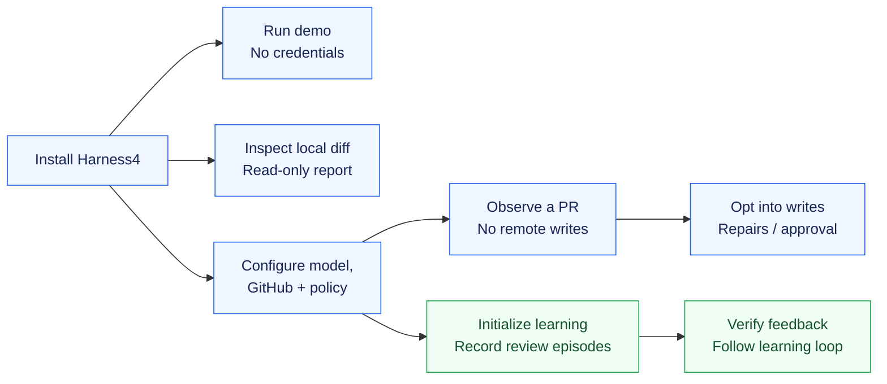
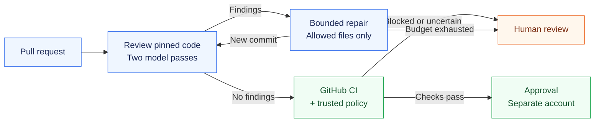
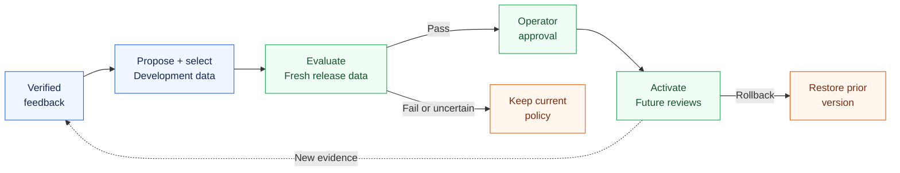

# Workflow reference

Detailed diagrams and command paths for the current alpha.

## Choose your first run

Start with the outcome you want. Each arrow below is a setup dependency; learning
is optional, and remote writes always need their own authorization.



| Your goal | Start here | What you get |
|---|---|---|
| **Understand the whole loop** | `python examples/learning_demo.py` | A scripted demonstration with real activation and rollback; no credentials. |
| **Inspect a local change** | `h4 ship --repo . --base HEAD~1 --head HEAD` | JSON policy report; add model settings for AI review. |
| **Review a GitHub PR** | [`h4 ship-github`](GITHUB_WORKFLOW.md) | Two review passes and actual CI evidence; observation by default. |
| **Enable remote actions** | Configure grants, then add `--write`; separately configure `--approve` | Bounded repairs and policy-gated approval; no merge. |
| **Improve future reviews** | [`h4 learning init`](LEARNING.md), then `ship-github --learning-dir …` | Recorded episodes for verified feedback and a separate evaluation cycle. |

For learning, the command sequence is `feedback` → `dataset` → `run --live` →
`inspect` → `approve` → `promote`. Each command takes explicit IDs and settings;
use the [complete walkthrough](LEARNING.md) rather than treating this sequence
as a shell command. If evaluation rejects or abstains, keep the current policy.
Use `rollback` to restore a prior version, or `retract` to correct bad evidence.

## How it works

Two connected loops: one handles a pull request; the other evaluates changes to the
review guidance used on future pull requests.



Remote writes require explicit opt-in and trusted policy grants. Approval requires
passing checks on the reviewed commit, a separate GitHub user and branch protection.
The coordinator does not execute PR code or merge PRs. See the
[GitHub workflow guide](GITHUB_WORKFLOW.md) for setup and recovery.

### Start with a local review

Inside the cloned repository, inspect the latest committed change without credentials:

```sh
h4 ship --repo . --base HEAD~1 --head HEAD
```

This produces a structured policy report without calling a model. To review another
repository with a model, configure `H4_MODEL_KEY` in your environment, then run:

```sh
h4 ship --repo /path/to/your/repo --base HEAD~1 --head HEAD \
  --model YOUR_MODEL --base-url https://YOUR_PROVIDER/v1 \
  --policy examples/ship-policy.json --checks unknown
```

Only committed changes are reviewed. Model calls send the diff to your configured
endpoint and may incur charges. Local recommendations are advisory; the local
command's exit code is not a merge gate. [Local review reference →](LOCAL_REVIEW.md)

### Connect a GitHub repository

Configure your repository policy, model credential and GitHub token using the
[setup guide](GITHUB_WORKFLOW.md), then start in observation mode:

```sh
h4 ship-github --policy /trusted/project-policy.json --pr 42 \
  --state-dir /trusted/state/github \
  --model YOUR_MODEL --base-url https://YOUR_PROVIDER/v1
```

Add `--write` to allow policy-permitted review posts and repairs. Add `--approve`
only after configuring the separate approval credential and branch protection.
To use an approved learned checklist and record feedback episodes, add
`--learning-dir /trusted/state/learning` after [initializing learning](LEARNING.md).

## A learning loop you can audit

A useful lesson needs evidence before it becomes the next review policy.



- **Separate development from release evidence.** The proposer sees development
  labels; the release cohort is consumed once, including after a crash.
- **Check improvement and retention.** Paired evaluations compare candidate and
  current policy. Confidence bounds and regression checks can reject or abstain.
- **Approve the exact version.** Activation checks the persisted report, policy
  generation, evidence validity, expiry and a one-use approval.
- **Reverse a decision.** Roll back an active policy, or retract incorrect feedback
  to invalidate dependent policies. The original baseline remains available.

The learnable surface today is the **review checklist**. Model weights, GitHub
permissions, execution code and evaluation rules stay fixed. Production learning
requires explicit inference budgets and independent, verified data; the default
gate requires at least 100 target and 100 regression source groups.

[Run a real learning cycle →](LEARNING.md) ·
[Research and design decisions →](research/2026-11-25-learning.md)


[Back to the README](../README.md).
